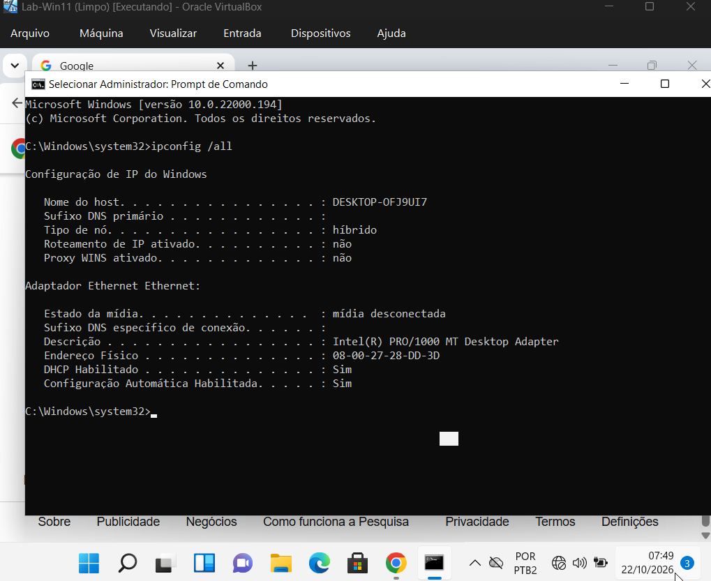
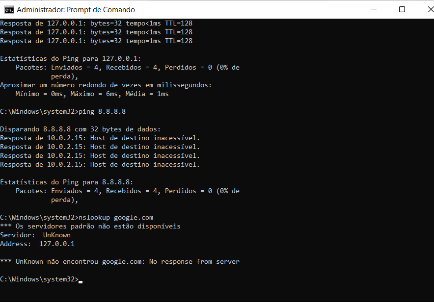
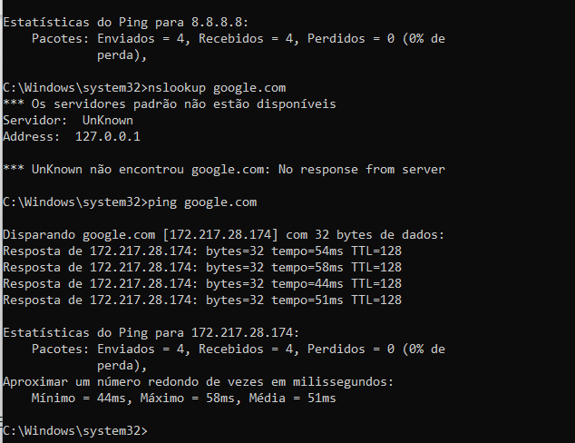

# Runbook 01: Computador sem internet

**Ambiente:** Windows 11 Enterprise Evaluation (10.0.22000.194), máquina virtual no VirtualBox, rede NAT · **Testado em:** 22/10/2026

## Sintoma
"Estou sem internet." O navegador não abre nenhum site.

## Impacto
Uma pessoa sem e-mail e sem sistemas na nuvem. Urgência média; alta se ela atende clientes.

## Antes de começar
Confirmar o nome do usuário e da máquina. Perguntar: mais alguém está sem internet? Desde quando? Mudou algo (cabo, Wi-Fi, atualização)?

## Como o defeito foi provocado
Com a máquina ligada, a placa de rede virtual foi desconectada no VirtualBox (cabo virtual removido). Ensaio em laboratório, dados fictícios.

## Diagnóstico
Do mais perto ao mais longe, no Prompt de Comando como administrador. A coluna "Obtido no ensaio" traz o que apareceu de verdade.

| Passo | Comando | Esperado (rede saudável) | Obtido no ensaio | Leitura |
| --- | --- | --- | --- | --- |
| 1 | `ipconfig /all` | Adaptador com IPv4 e gateway, sem aviso de mídia | "Estado da mídia: mídia desconectada" no adaptador Intel PRO/1000 MT; nenhum IPv4 listado | O Windows não detecta cabo. O defeito está no cabo ou na placa, antes de qualquer configuração |
| 2 | `ping 127.0.0.1` | Respostas | 4 respostas (de 0 a 6 ms) | Só o software de rede do Windows funciona. Não testa cabo nem placa: respondeu com o cabo desconectado |
| 3 | `ping 10.0.2.2` (gateway) | Respostas | Não executado neste ensaio | Com a mídia conectada, separa defeito local (falha aqui) de defeito além do roteador (responde aqui e falha no passo 4) |
| 4 | `ping 8.8.8.8` | Respostas vindas do 8.8.8.8 | 4 vezes "Resposta de 10.0.2.15: Host de destino inacessível." | A resposta veio do IP da própria máquina (10.0.2.15, o padrão do VirtualBox em NAT): o PC não achou caminho para sair. Defeito local |
| 5 | `nslookup google.com` | Devolve um endereço | "Os servidores padrão não estão disponíveis", "Servidor: UnKnown", "Address: 127.0.0.1", "No response from server" | O PC não tinha servidor DNS configurado. Consequência da falta de rede, não defeito do DNS |

Atenção ao passo 4: o resumo do ping mostrou "Recebidos = 4, Perdidos = 0 (0% de perda)", mas nenhuma resposta era do 8.8.8.8. O Windows conta o aviso "inacessível" como pacote recebido. Leia as linhas, não só o resumo.

## Causa
Placa de rede virtual desconectada (cabo virtual removido). O passo 1 mostrou "mídia desconectada".

## Solução
1. Reconectar a placa de rede virtual: VirtualBox → Dispositivos → Rede → Conectar Placa de Rede.

## Verificação
`ping google.com` resolveu google.com para 172.217.28.174 e teve 4 respostas (44 a 58 ms, média de 51 ms), 0% de perda.

## Escalonamento
Se a mídia aparece conectada e o gateway (passo 3) não responde, passar ao N2 (quem cuida da rede ou da operadora), levando os resultados dos passos 1 a 5 e a hora em que o problema começou.

## Prevenção
Etiquetar cabos e registrar na ficha da máquina o gateway e o DNS esperados.

## Evidências

