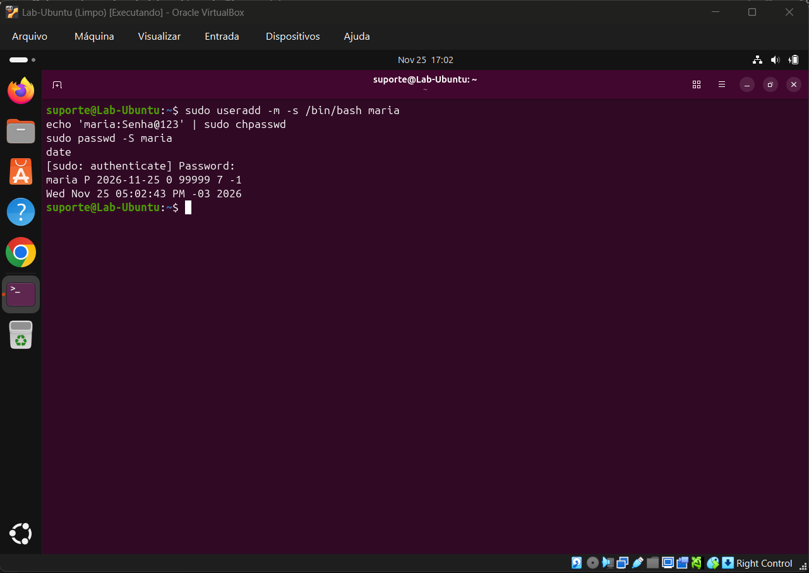
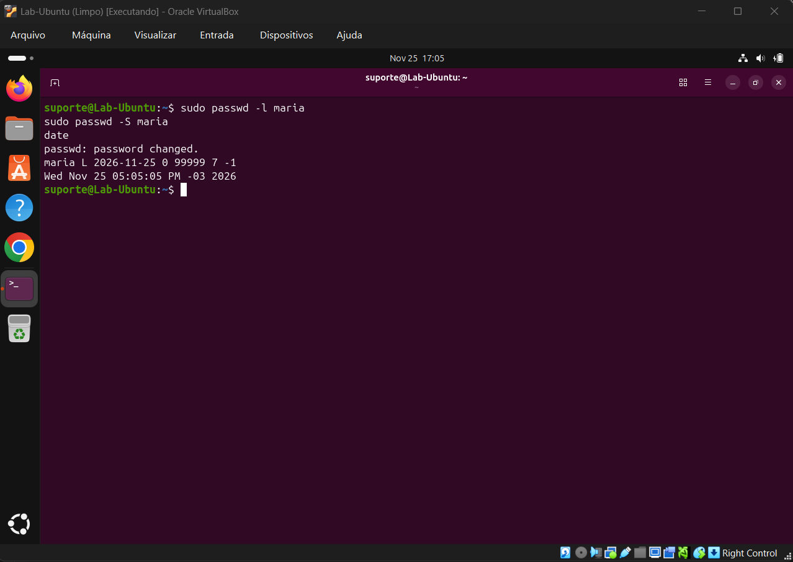
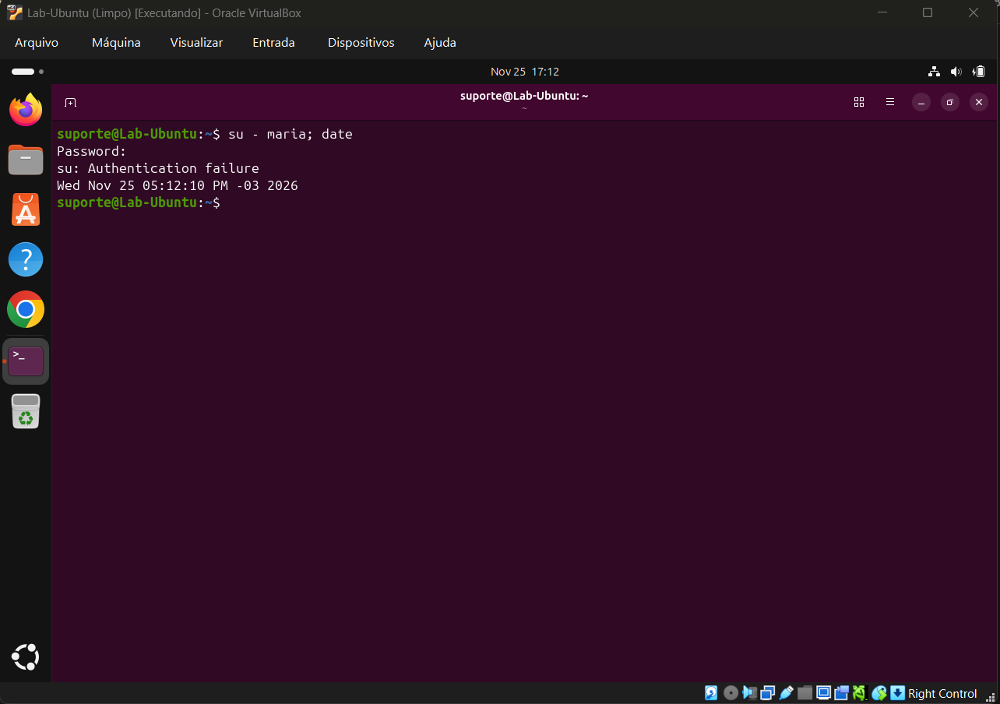
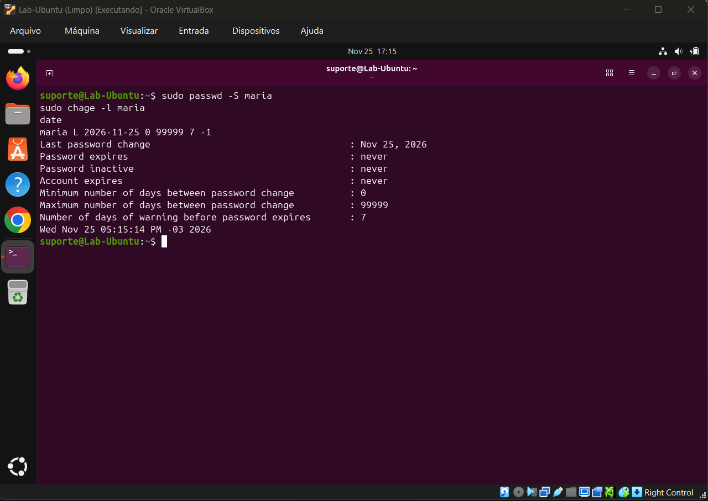
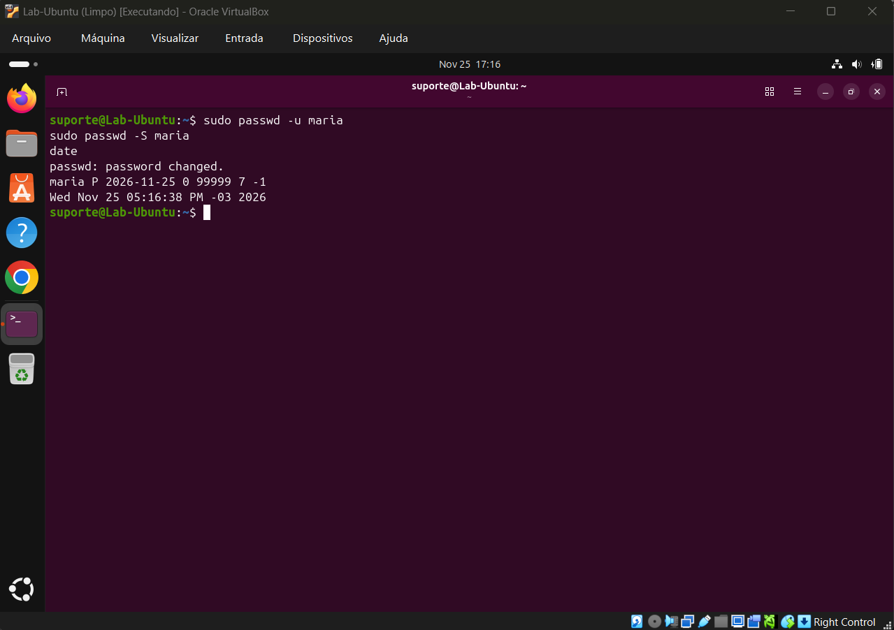
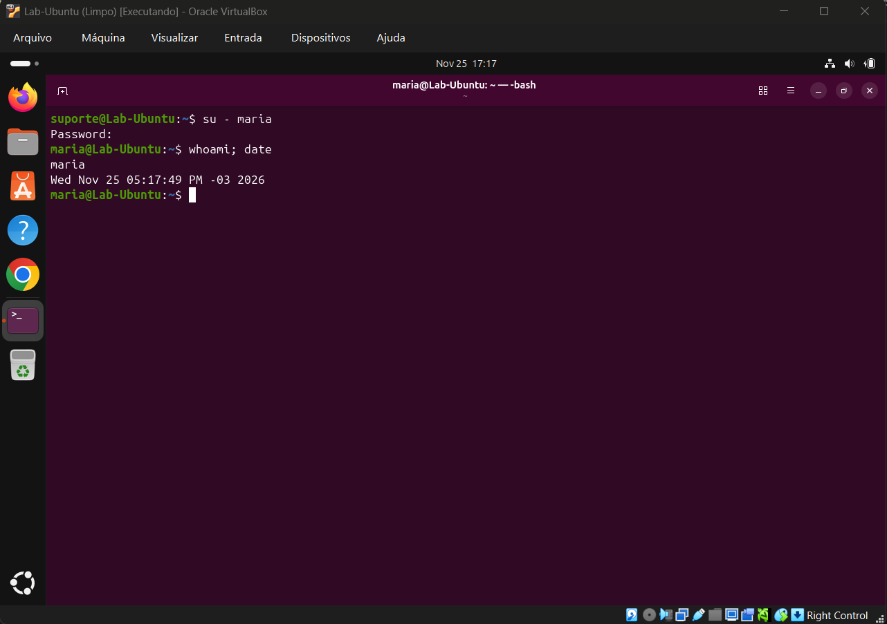
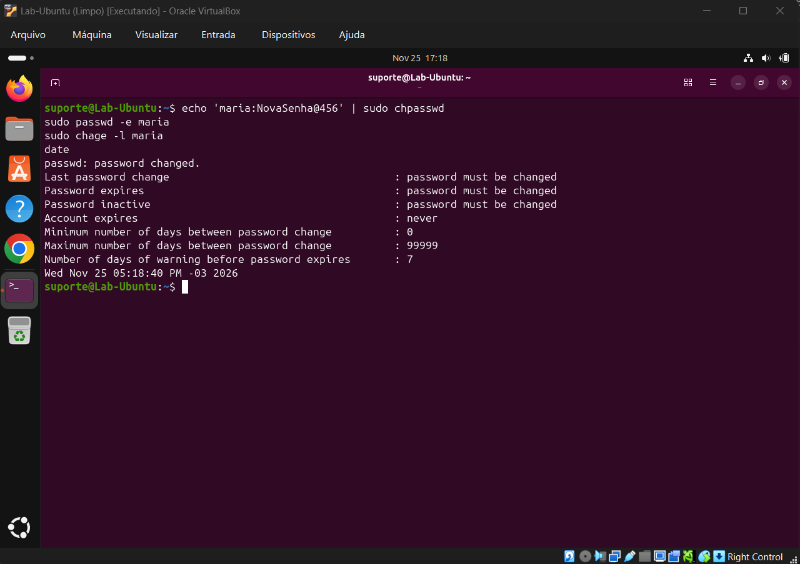
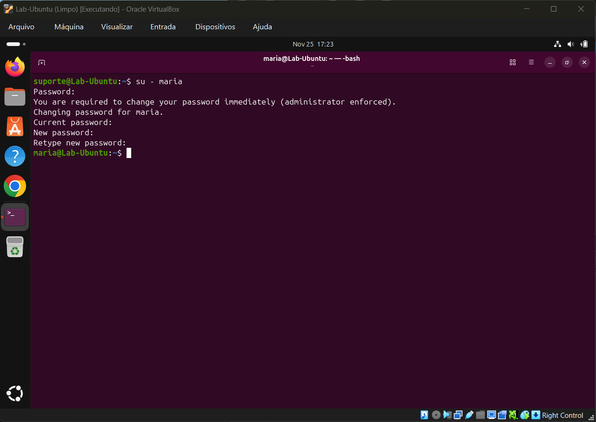
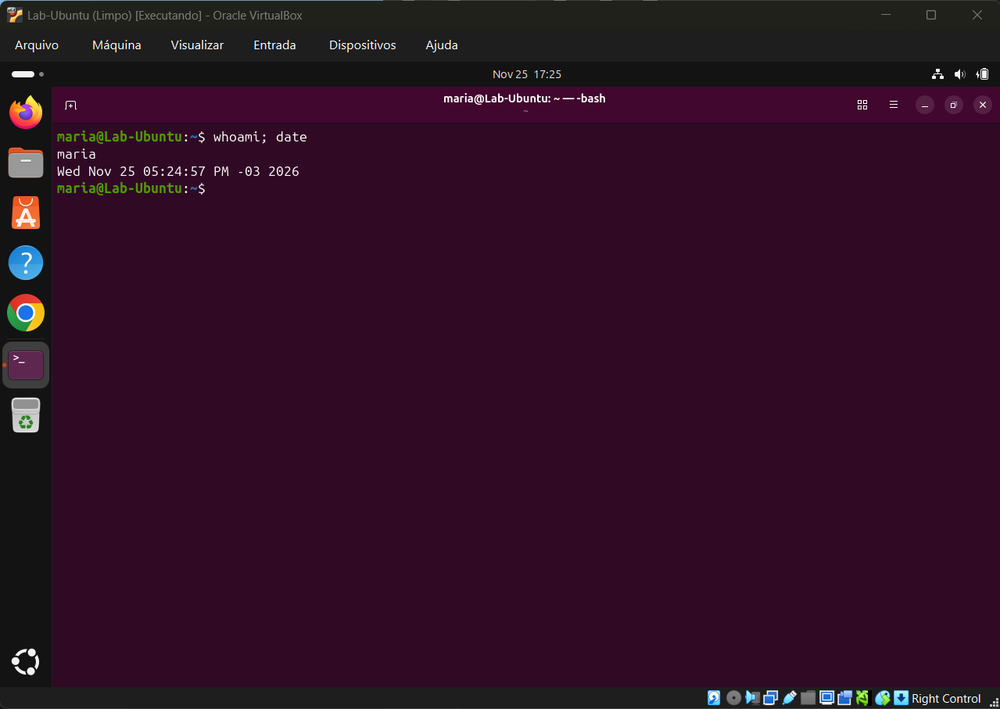
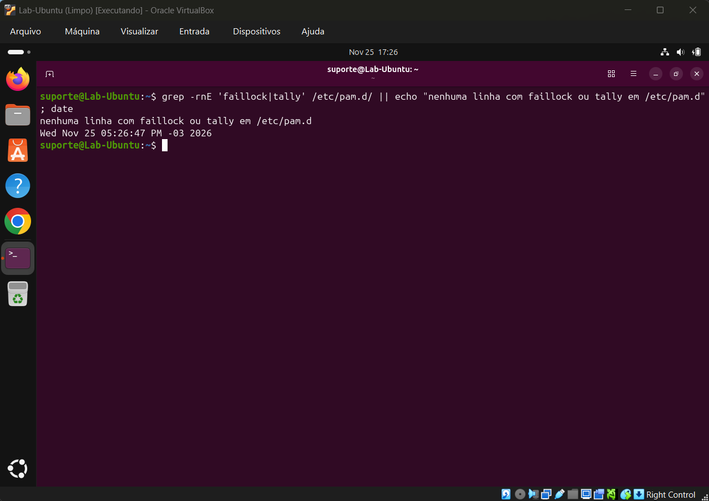

# Runbook 02 (Ubuntu): Esqueci a senha e minha conta bloqueou

**Ambiente:** Ubuntu 26.04.1 LTS, máquina virtual no VirtualBox, a partir do snapshot "Limpo" · **Testado em:** 25/11/2026

Este é o mesmo pedido do [runbook 02 de Windows](02-esqueci-a-senha-conta-bloqueada.md), refeito no Ubuntu com as ferramentas do Linux.

## Sintoma
"Esqueci minha senha e minha conta bloqueou." A pessoa digita a senha e o Ubuntu não deixa entrar. No ensaio, tentei entrar na conta da Maria com `su - maria` e digitei a senha certa. O Terminal respondeu `su: Authentication failure` (print 3). A mensagem da tela gráfica de entrada **não foi testada**.

## Impacto
Uma pessoa sem conseguir entrar na máquina, ou seja, sem trabalhar. Urgência alta.

## Antes de começar
**Confirmar quem está pedindo, antes de mexer na conta.** Seguir o procedimento da empresa, por exemplo ligar de volta para o telefone cadastrado ou pedir a confirmação do gestor. Nunca pedir a senha atual da pessoa. Neste ensaio, a Maria é uma usuária fictícia e a identidade dela já estava confirmada.

Perguntar: a conta é do próprio computador (local) ou de um servidor de contas da empresa? A pessoa errou a senha ou esqueceu? Desde quando? Alguém bloqueou a conta de propósito, por exemplo porque a pessoa saiu da empresa? A entrada é pela tela gráfica, pelo Terminal ou à distância, por SSH (*Secure Shell*, entrada remota pelo Terminal)? Este runbook trata de conta local, no Terminal, que foi o que testei. Conta de servidor de contas, tela gráfica e SSH: **não testado**.

Termos:
- **Conta bloqueada**, no Linux, é a conta cuja senha foi travada: ela continua existindo, mas nenhuma senha serve. Exemplo: depois de `sudo passwd -l maria`, a Maria digita a senha certa e é recusada (print 3).
- **`sudo`** executa um comando com poderes de administrador. Exemplo: `sudo passwd -l maria`. Nesta máquina o `sudo` é o `sudo-rs` 0.2.13 (print 11), uma reescrita do `sudo` na linguagem Rust, que o Ubuntu usa como padrão desde a versão 25.10 (ver Fontes).
- **`passwd`** cuida de senhas. O `-S` mostra o estado, o `-l` trava, o `-u` destrava e o `-e` faz a senha expirar, para a pessoa trocá-la no próximo acesso. Exemplo: `sudo passwd -S maria`.
- **`chage`** mostra e muda as datas de validade da senha e da conta. Exemplo: `sudo chage -l maria` lista essas datas.
- **`su - maria`** troca para a conta da Maria no mesmo Terminal e pede a senha dela.
- **PAM** (*Pluggable Authentication Modules*) é o conjunto de módulos que o Linux usa para conferir a senha. As regras ficam na pasta `/etc/pam.d`.
- **LTS** (*Long Term Support*) é uma versão do Ubuntu com suporte de longo prazo.

## Como o defeito foi provocado
Partindo do snapshot "Limpo", com o Terminal (a janela de comandos) aberto na conta `suporte`. Antes de cada bloco, digitei `clear` sozinho, que limpa a tela. Colei o bloco com Ctrl+Shift+V (no Terminal, o Ctrl+V sozinho não cola) e dei Enter. Todo bloco termina com `date`, que mostra a data e a hora. Os prints são só da janela da máquina virtual, com o Terminal maximizado e o texto ampliado (Ctrl + roda do mouse). Ensaio em laboratório, dados fictícios. As senhas deste runbook (`Senha@123`, `NovaSenha@456` e `Maria@2026x`) são fictícias, de uma máquina virtual descartável.

**Passo 1: criar a usuária Maria (print 1).**

```
sudo useradd -m -s /bin/bash maria
echo 'maria:Senha@123' | sudo chpasswd
sudo passwd -S maria
date
```

O `useradd` cria a usuária. O `-m` cria a pasta pessoal dela e o `-s /bin/bash` escolhe o programa de linha de comando (o shell) que ela usa. O `echo` escreve `maria:Senha@123`, e o `|` entrega esse texto ao `chpasswd`, que define a senha. O `sudo` pediu a minha senha (`[sudo: authenticate] Password:`), a da conta `suporte`. Nada apareceu enquanto eu digitava, nem asteriscos. Nos passos 2, 4, 5 e 7, que também usam `sudo`, ele não pediu de novo. O `passwd -S` mostrou `maria P 2026-11-25 0 99999 7 -1`. O `P` quer dizer senha em uso (o `L` é senha travada). Depois da data vêm os prazos da senha, em dias: mínimo, máximo, aviso e inatividade.

**Passo 2: travar a conta, que é o defeito (print 2).**

```
sudo passwd -l maria
sudo passwd -S maria
date
```

O `-l` trava a senha. A resposta foi `passwd: password changed.`, e o status passou de `P` para `L`: `maria L 2026-11-25 0 99999 7 -1`. O defeito, aqui, é um bloqueio feito por um administrador, e não senhas erradas seguidas.

## Diagnóstico: conta bloqueada
Do sintoma até o dado que prova o bloqueio. A coluna "Obtido no ensaio" traz o que apareceu de verdade. O número do print aponta para a seção Evidências.

**Passo 3: ver o sintoma (print 3).**

```
su - maria; date
```

Digitei a senha certa, `Senha@123`, quando o `su` pediu (`Password:`). No Terminal do Ubuntu nada aparece quando se digita uma senha: nem letras, nem asteriscos, e o cursor não anda. Vi isso no `sudo` (passo 1) e no `su`. Não é defeito do teclado.

**Passo 4: o estado da conta (print 4).**

```
sudo passwd -S maria
sudo chage -l maria
date
```

| Print | Comando ou ação | Obtido no ensaio | Leitura |
| --- | --- | --- | --- |
| 3 | `su - maria`, com a senha certa | `Password:` e depois `su: Authentication failure` (17:12:10) | A senha certa foi recusada. A mensagem não diz o motivo |
| 4 | `sudo passwd -S maria` | `maria L 2026-11-25 0 99999 7 -1` (17:15:14) | O `L` mostra que a senha está travada |
| 4 | `sudo chage -l maria` | A lista abaixo | A senha e a conta não expiram (`never`). Isso afasta a validade vencida como causa |

O que o `chage -l` mostrou (print 4), como saiu, em inglês porque a máquina está em inglês:

| Campo | Valor |
| --- | --- |
| Last password change | Nov 25, 2026 |
| Password expires | never |
| Password inactive | never |
| Account expires | never |
| Minimum number of days between password change | 0 |
| Maximum number of days between password change | 99999 |
| Number of days of warning before password expires | 7 |

A mensagem do print 3 só diz que a autenticação falhou, e não que a conta está bloqueada. Quem mostra o bloqueio é o `passwd -S` do print 4 (`L`). Não testei o `su` com senha errada para comparar as mensagens.

**Extra: o Ubuntu bloqueia sozinho por senhas erradas? (print 10).** Conferi no fim do ensaio:

```
grep -rnE 'faillock|tally' /etc/pam.d/ || echo "nenhuma linha com faillock ou tally em /etc/pam.d"; date
```

O `grep` procura as palavras `faillock` e `tally` em todos os arquivos da pasta `/etc/pam.d`. O `pam_faillock` é o módulo do PAM que conta as senhas erradas e bloqueia a conta depois de um número de falhas seguidas. O manual dele compara a configuração com a do `pam_tally2`, por isso procurei também por `tally` (ver Fontes). Se o `grep` não achar nada, o `echo` escreve a frase. Saiu a frase: nenhuma linha encontrada (17:26:47). Isso mostra só a configuração. Não errei a senha várias vezes para ver o que acontece.

## Causa
Senha da conta travada com `passwd -l` (status `L`). Prints 2, 3 e 4. No ensaio fui eu que travei. Num chamado real, descobrir quem travou e por quê, antes de destravar.

## Solução
Os números dos passos seguem a ordem em que executei no ensaio. O passo 6, que confere o desbloqueio, está na Verificação.

1. Confirmar quem está pedindo e se o bloqueio foi de propósito (ver "Antes de começar").
2. **Passo 5: destravar a senha (print 5).**

```
sudo passwd -u maria
sudo passwd -S maria
date
```

Resultado: `passwd: password changed.`, a mesma frase do `-l`, e o status voltou para `P`: `maria P 2026-11-25 0 99999 7 -1` (17:16:38). Como a frase não muda, quem mostra o que aconteceu é o `passwd -S`. Segundo o manual, o `-u` devolve a senha ao valor que ela tinha antes do `-l`. Se a pessoa lembra a senha, o desbloqueio basta; conferir entrando na conta (passo 6).

3. Se a pessoa esqueceu a senha, definir uma senha temporária e exigir a troca no próximo acesso (**passo 7, print 7**):

```
echo 'maria:NovaSenha@456' | sudo chpasswd
sudo passwd -e maria
sudo chage -l maria
date
```

Resultado: o `chpasswd` não imprimiu nada, e o `passwd -e` respondeu `passwd: password changed.` No `chage -l`, as linhas `Last password change`, `Password expires` e `Password inactive` passaram a mostrar `password must be changed`. As outras quatro ficaram iguais às do print 4 (17:18:40).

## Verificação
- **Passo 6 (print 6).** Depois do desbloqueio, entrei na conta da Maria com a senha antiga: `su - maria` e `Senha@123`. Dentro da sessão dela rodei `whoami; date`. O prompt virou `maria@Lab-Ubuntu:~$` e o `whoami`, que mostra o nome de quem está na sessão, respondeu `maria` (17:17:49). Depois digitei `exit` para voltar à conta `suporte`.
- **Passo 8 (print 8).** Com a senha temporária, `su - maria` e `NovaSenha@456` no `Password:`. O Ubuntu avisou `You are required to change your password immediately (administrator enforced).` e `Changing password for maria.` Pediu `Current password:` (digitei `NovaSenha@456`), `New password:` e `Retype new password:` (digitei `Maria@2026x` nas duas). Depois disso o `su` não mostrou mensagem nenhuma e abriu a sessão da Maria, com o prompt `maria@Lab-Ubuntu:~$`. Esse passo não tem `date`; o relógio da barra do Ubuntu marcava 17:23.
- **Passo 9 (print 9).** Na sessão da Maria, `whoami; date` respondeu `maria` (17:24:57). Depois digitei `exit`.

## E num PC de verdade
- **Conta de servidor de contas da empresa.** Os comandos deste runbook mexem na conta local e podem não resolver. **Não testado.**
- **Tela gráfica de entrada.** Entrei só pelo Terminal, com `su`. Como a tela gráfica reage a uma conta travada, e que mensagem ela mostra: **não testado.**
- **Entrada por SSH.** O manual do `passwd` avisa que o `-l` trava só a senha: a pessoa ainda pode entrar por outro meio, como uma chave SSH. Para desativar a conta de verdade, o manual indica `usermod --expiredate 1`. **Não testado.**
- **Bloqueio por tentativas erradas.** Só conferi a configuração (print 10). Se uma conta travar assim, o manual do `faillock` diz que ele mostra as falhas registradas e também as limpa. **Não testado.**
- **Outras versões do Ubuntu.** O ensaio foi no 26.04.1, com o `sudo-rs`. As mensagens podem variar em outras versões. **Não testado.**

## Escalonamento
Passar ao N2 (o segundo nível do suporte) se:
- o `passwd -S` não mostrar `L` e a pessoa continuar sem entrar: é outra causa, que este runbook não cobre (no ensaio o status foi `L`);
- depois do `passwd -u` o status continuar `L`, ou a conta voltar a ficar bloqueada logo depois (não aconteceu no ensaio);
- a conta for de um servidor de contas da empresa (não testei);
- ninguém confirmar quem está pedindo, ou o bloqueio tiver sido de propósito e ninguém autorizar o desbloqueio.

Registrar no chamado a mensagem exata da tela e o resultado do `passwd -S` e do `chage -l`.

## Prevenção
- Antes de destravar, perguntar se o bloqueio foi de propósito (por exemplo, pessoa que saiu da empresa).
- Passar a senha temporária por um canal seguro e exigir a troca no primeiro acesso, como no passo 7.
- Num chamado real, não digitar a senha dentro do comando: ela fica visível na tela e pode ir para o histórico de comandos. O comando `sudo passwd maria` pede a senha sem mostrá-la. Não testei isso neste ensaio, nem conferi o histórico. As senhas digitadas aqui são fictícias.
- Avisar a pessoa de que, no Terminal, nada aparece quando se digita a senha. Eu mesmo achei que o teclado tinha falhado (ver "O que não funcionou").

## Notas do ensaio
**Tempo gasto.** Do primeiro comando (print 1, 17:02:43) ao print 9 (17:24:57) passaram 22 min 14 s. O roteiro estimava 25 minutos. Até o print 10 (17:26:47) foram 24 min 4 s. Isso inclui cerca de 2 minutos refazendo o passo 3. Não contei a preparação: restaurar o snapshot "Limpo", iniciar a máquina, abrir o Terminal e ajustar o tamanho da janela e do texto.

**O que não funcionou.** Na 1ª tentativa do passo 3, nada apareceu enquanto eu digitava a senha. Achei que o teclado não estava funcionando e dei Enter achando que não tinha digitado nada. O `su` respondeu `su: Authentication failure`. Não sei dizer se a senha chegou a ser digitada nessa tentativa, porque ela não aparece. Refiz o passo 3 digitando `Senha@123` e dando Enter, e o resultado foi o mesmo (print 3). Foi a única repetição do ensaio.

**Diferenças em relação ao previsto.**
- O roteiro estimava cerca de 25 minutos e 9 prints. Levou 22 min 14 s até o print 9, e acrescentei 2 prints: o 10 (regras do PAM) e o 11 (versões do Ubuntu e do `sudo`).
- O roteiro partia da ideia de que o Ubuntu não bloqueia a conta por senhas erradas por padrão. O print 10 vai no mesmo sentido (nenhuma linha com `faillock` ou `tally`), mas só mostra a configuração.
- O roteiro não conferia o texto exato das mensagens do `su` e do `passwd` no Ubuntu 26.04. Saíram assim: `su: Authentication failure` (print 3), `passwd: password changed.` no `-l`, no `-u` e no `-e` (prints 2, 5 e 7) e `You are required to change your password immediately (administrator enforced).` (print 8).
- O `-l`, o `-u` e o `-e` respondem com a mesma frase. Só o `passwd -S` e o `chage -l` mostram o que mudou.
- Depois da troca obrigatória de senha, o `su` não mostrou mensagem de sucesso: o prompt da Maria apareceu direto (print 8).
- O `sudo` pediu a senha só no passo 1. O maior intervalo entre dois comandos com `sudo` sem pedir de novo foi de cerca de 10 minutos (17:05:05 a 17:15:14, prints 2 e 4).
- A senha `Maria@2026x` foi aceita sem aviso, embora contenha o nome da usuária (print 8).

**Prints que não publiquei.**
- Passo 3, 1ª tentativa: duas imagens (parada no `Password:` e com `su: Authentication failure`), pelo motivo descrito acima.
- Passo 6: uma imagem com o `exit` e o `logout` depois do print 6, que mostra a volta ao prompt `suporte@Lab-Ubuntu:~$`.
- Passo 8: três imagens, uma em cada pergunta (`Current password:`, `New password:` e `Retype new password:`). O print 8 é a última e mostra a sequência inteira.

**O que não conferi.**
- Se o `su: Authentication failure` é também a mensagem para senha errada: não errei a senha de propósito.
- Se o Ubuntu bloqueia a conta depois de várias senhas erradas. O print 10 mostra só a configuração.
- O `!` que, segundo o manual, o `passwd -l` põe na frente da senha: não abri o arquivo `/etc/shadow`.
- Se o bloqueio vale também na tela gráfica de entrada e no SSH.
- Se o Ubuntu confere o nome da usuária dentro da senha, e se diferencia maiúsculas: `Maria@2026x` foi aceita.
- A versão do `su`: no print 11 só conferi a do `sudo`.
- As datas do `chage -l` depois da troca de senha: não rodei o comando de novo.
- A cor da barra de título do Terminal. Em imagens que não publiquei (1ª tentativa do passo 3 e troca de senha do passo 8), ela ficou vermelha enquanto o `su` esperava a senha. Nos prints publicados ela está na cor normal. Não verifiquei o motivo.

## Fontes
Os comandos vêm do roteiro do laboratório, e o resto está nos prints. Consultei na web, em 25/11/2026, os manuais abaixo. Podem não ser da mesma versão instalada na máquina (a página do Ubuntu é da 24.10), e não rodei `man passwd` nela.
- Manual do `passwd` (o que o `-l`, o `-u`, o `-S` e o `-e` fazem, e o aviso de que o `-l` trava só a senha): [man7.org](https://man7.org/linux/man-pages/man1/passwd.1.html) e [Ubuntu Manpages, versão "oracular" (Ubuntu 24.10)](https://manpages.ubuntu.com/manpages/oracular/man1/passwd.1.html).
- Manual do `pam_faillock` (o que o módulo faz e o `pam_tally2` citado nele): [man7.org](https://man7.org/linux/man-pages/man8/pam_faillock.8.html).
- Manual do `faillock` (mostrar e limpar as falhas registradas): [man7.org](https://man7.org/linux/man-pages/man8/faillock.8.html).
- O que é o `sudo-rs` e a adoção como padrão no Ubuntu 25.10: [Ubuntu Discourse, "Adopting sudo-rs By Default in Ubuntu 25.10"](https://discourse.ubuntu.com/t/adopting-sudo-rs-by-default-in-ubuntu-25-10/60583).

## Evidências
**Print 1.** Criação da usuária Maria e o status `P` (17:02:43).


**Print 2.** Conta travada com `passwd -l` e o status `L` (17:05:05).


**Print 3.** `su - maria` com a senha certa: `su: Authentication failure` (17:12:10).


**Print 4.** Diagnóstico: o status `L` e as datas da conta no `chage -l` (17:15:14).


**Print 5.** Depois do `passwd -u`: o status `P` de novo (17:16:38).


**Print 6.** `su - maria` com a senha antiga funcionando: o prompt da Maria e `whoami` (17:17:49).


**Print 7.** Senha temporária definida e o `chage -l` com `password must be changed` (17:18:40).


**Print 8.** Troca obrigatória da senha no primeiro acesso, da pergunta `Current password:` até o prompt da Maria (sem `date`; o relógio da barra do Ubuntu marca 17:23).


**Print 9.** `whoami` na sessão da Maria (17:24:57).


**Print 10.** Extra: busca de `faillock` e `tally` em `/etc/pam.d`, sem nenhuma linha encontrada (17:26:47).


**Print 11.** Extra: versão do Ubuntu (26.04.1 LTS) e do `sudo` (`sudo-rs` 0.2.13) (17:50:26).

