# Runbook 02: Esqueci a senha e minha conta bloqueou

**Ambiente:** Windows 11 Enterprise Evaluation (10.0.22000.194), máquina virtual no VirtualBox · **Testado em:** 03/11/2026

## Sintoma
"Esqueci minha senha e minha conta bloqueou." Na tela de entrada, o Windows recusa a senha. Depois de algumas tentativas, a mensagem muda para: "A conta referenciada está bloqueada no momento e pode não ser possível fazer logon." (print 3b)

## Impacto
Uma pessoa sem conseguir entrar no PC, ou seja, sem trabalhar. Urgência alta.

## Antes de começar
**Confirmar quem está pedindo, antes de mexer na conta.** Seguir o procedimento da empresa, por exemplo ligar de volta para o telefone cadastrado ou pedir a confirmação do gestor. Nunca pedir a senha atual da pessoa. Neste ensaio, a Maria é uma usuária fictícia e a identidade dela já estava confirmada.

Perguntar: a conta é do próprio PC (local), do domínio da empresa ou da Microsoft? A pessoa errou a senha ou realmente esqueceu? Desde quando? Este runbook trata de conta local, que foi o que testei. Conta de domínio e conta Microsoft: não testado.

Dois termos. **Conta bloqueada** é a que o Windows trava depois de várias senhas erradas seguidas. **Conta desativada** é outra coisa: um administrador a desliga de propósito, por exemplo para quem saiu da empresa. Saber qual das duas é o primeiro passo do diagnóstico.

## Como o defeito foi provocado
No PowerShell como administrador, a partir do snapshot "Limpo", criei a usuária fictícia Maria e liguei a regra de bloqueio: 3 senhas erradas seguidas travam a conta. Depois, na tela de entrada, errei a senha da Maria de propósito (`errada1`) até a conta bloquear, o que aconteceu na 4ª tentativa. A regra vale para todas as contas da máquina. Ensaio em laboratório, dados fictícios. As senhas deste runbook (`Senha@123`, `NovaSenha@456` e `Maria@2026x`) são fictícias, de uma máquina virtual descartável.

## Ponto de partida: antes do defeito
O Windows em português chama de "proteção" o que o inglês chama de *lockout* (bloqueio por tentativas erradas). A linha "Limite de proteção" é o número de senhas erradas que bloqueia a conta.

| Print | Comando ou ação | Obtido no ensaio |
| --- | --- | --- |
| 1 | `net accounts; Get-Date` | Limite de proteção: Nunca (nenhuma conta trava). Duração da proteção: 30 minutos. Janela de observação de proteção: 30 minutos. Duração máxima da senha: 42 dias. Comprimento mínimo da senha: 0 |
| 2 | `net user maria Senha@123 /add`, `net accounts /lockoutthreshold:3` e `net accounts` | "Comando concluído com êxito." duas vezes e, na tabela, Limite de proteção: 3 |

A duração da proteção é por quanto tempo a conta fica bloqueada antes de se soltar sozinha. A janela de observação é por quanto tempo o Windows conta as senhas erradas seguidas. Li os dois valores (30 minutos) nos prints. Não esperei os 30 minutos para ver a conta se soltar sozinha.

## Diagnóstico: conta bloqueada
Da mensagem na tela até o dado que prova o bloqueio. A coluna "Obtido no ensaio" traz o que apareceu de verdade. O número do print aponta para a seção Evidências.

| Print | Comando ou ação | Esperado | Obtido no ensaio | Leitura |
| --- | --- | --- | --- | --- |
| 3a | Tela de entrada, senha errada | Aviso de senha incorreta | "A senha está incorreta. Tente novamente." | Só uma senha errada. Ainda não é bloqueio |
| 3b | Continuar errando até a 4ª tentativa | Aviso de conta bloqueada | "A conta referenciada está bloqueada no momento e pode não ser possível fazer logon." | Bloqueio por excesso de tentativas |
| 4 | `net user maria; Get-Date` | "Conta ativa: Sim", sem sinal de bloqueio (era a minha previsão) | "Conta ativa: **Bloqueado**" | A ficha da conta já mostra o bloqueio. Diferente do que eu previa |
| 5 | `Get-CimInstance Win32_UserAccount -Filter "Name='maria' AND LocalAccount=True" \| Format-Table Name, Disabled, Lockout -AutoSize; Get-Date` | `Disabled False` e `Lockout True` | `maria`, `Disabled False`, `Lockout True` | Não está desativada (`Disabled`) e está bloqueada (`Lockout`) |
| 6 | `lusrmgr.msc` → Usuários → dois cliques em maria | Caixa de bloqueio marcada | "Conta bloqueada" marcada; "Conta desativada" desmarcada | A mesma informação, numa janela com caixas |

Atenção ao print 4: "Conta ativa" mostra "Bloqueado" quando a conta está bloqueada. Não confundir com conta desativada. Para saber qual das duas, usar a consulta do print 5: `Disabled` é desativada, `Lockout` é bloqueada.

## Causa
Conta bloqueada pelo Windows depois de senhas erradas seguidas (limite de 3 no ensaio). Prints 3b, 4, 5 e 6.

## Solução
1. Confirmar quem está pedindo (ver "Antes de começar").
2. Desbloquear a conta: `net user maria /active:yes`. Resultado: "Comando concluído com êxito." e, na consulta seguinte, `Lockout False` (print 7). O `/active:yes` liga a conta; neste ensaio ele também tirou o bloqueio.
3. Se a pessoa esqueceu a senha, definir uma senha temporária e exigir a troca no próximo acesso:
```
net user maria NovaSenha@456
net user maria /logonpasswordchg:yes
Get-LocalUser maria | Format-Table Name, Enabled, PasswordLastSet -AutoSize
```
Resultado (print 8): os dois comandos terminaram com "Comando concluído com êxito." e a consulta mostrou `maria`, `Enabled True` e `PasswordLastSet` vazio. No primeiro acesso, o Windows exigiu a troca (print 9a).

Plano B, que não usei: desmarcar "Conta bloqueada" na janela do `lusrmgr.msc` (print 6). Não foi necessário e não testei. Outra saída é esperar: com a configuração do ensaio, a conta se solta sozinha depois de 30 minutos (print 1). Também não testei.

## Verificação
- `Lockout False` depois do `/active:yes` (print 7, 18:47:24).
- Entrando como Maria com a senha temporária, o Windows avisou: "A senha do usuário deve ser alterada antes da entrada." (print 9a). A tela seguinte pediu a senha antiga, a nova e a confirmação (print 9b). Defini `Maria@2026x` e o Windows respondeu "A senha foi alterada." (print 9c).
- Na conta da Maria, num PowerShell comum, `whoami` mostrou `desktop-ofj9ui7\maria` (print 10, 18:53:59).

## Desfazer a regra do ensaio
A regra de 3 tentativas foi só do ensaio. Para desligar: `net accounts /lockoutthreshold:0`. O resultado foi "Limite de proteção: Nunca" (print 11, 18:59:24). Num PC de verdade, a política de bloqueio é decisão da empresa, e o N1 não a muda.

## Escalonamento
Passar ao N2 se:
- o bloqueio continuar (`Lockout True`) depois do `/active:yes` (não aconteceu no ensaio);
- a conta for de domínio ou da Microsoft (não testei);
- a conta bloquear de novo logo depois, sem a pessoa ter errado a senha. Pode haver um programa, um celular ou uma pasta de rede ainda usando a senha antiga, ou alguém tentando entrar. É uma hipótese comum, não testada aqui.

Registrar no chamado a mensagem exata da tela e o resultado de `net user` e de `Lockout`.

## Prevenção
- Orientar a pessoa a parar depois de duas senhas erradas e chamar o suporte, em vez de tentar a terceira.
- Depois de trocar a senha, atualizar a senha salva em celular, programas e pastas de rede, para não gerar novos bloqueios.
- Passar a senha temporária por um canal seguro e exigir a troca no primeiro acesso, como no passo 3 da solução.
- Num chamado real, não digitar a senha dentro do comando: ela fica visível na tela e no histórico do PowerShell. O comando `net user maria *` pede a senha sem mostrá-la. Não testei isso neste ensaio. As senhas digitadas aqui são fictícias.
- Na conta local, a tela de troca de senha oferece "Criar um disco de redefinição de senha" (print 9b). Não testei.

## Notas do ensaio
**Tempo gasto.** Os prints do ensaio vão de 18:23 a 18:59, ou seja, 36 minutos do print 1 ao print 11. Os trechos mais longos foram as trocas de usuário: do print 2 ao print 4 passaram 9 minutos (sair, errar a senha da Maria até bloquear, voltar à minha conta e abrir o PowerShell); do print 8 ao print 10, 5 minutos (entrar como Maria e trocar a senha); do print 10 ao print 11, 5 minutos (voltar à minha conta). As telas de entrada do Windows não mostram relógio, por isso os prints 3a, 3b, 9a, 9b e 9c não têm hora.

**O que não funcionou no começo.**
- O primeiro print 5 saiu sem a hora: o `Get-Date` não mostrou nada depois da tabela do `Select-Object`. Troquei a consulta por `Format-Table ... -AutoSize; Get-Date`, e a data apareceu (print 5).

**Diferenças em relação ao previsto.**
- A linha do bloqueio se chama "Limite de proteção", e não "Limite de bloqueio" (prints 1, 2 e 11).
- A mensagem de êxito é "Comando concluído com êxito.", sem o "O ... foi" que eu esperava (print 2).
- O `net user maria` já mostra o bloqueio: "Conta ativa: Bloqueado". Eu esperava "Sim" (print 4).
- A caixa da janela gráfica se chama "Conta bloqueada", e não "A conta está bloqueada" (print 6).
- O `net user maria /active:yes` tirou o bloqueio (print 7). Antes do ensaio, isso era uma dúvida.
- O `PasswordLastSet` veio vazio, como eu esperava (print 8).

## Evidências
**Print 1.** `net accounts` antes do defeito, com o limite de proteção em "Nunca".
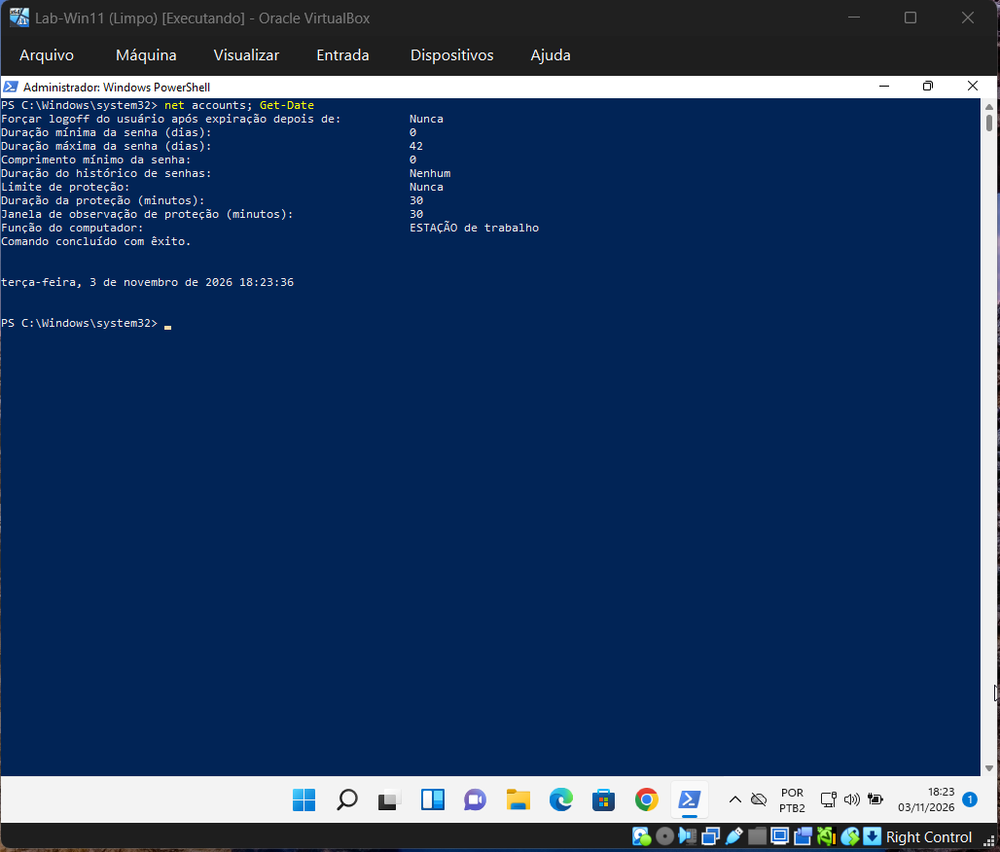

**Print 2.** Criação da usuária Maria e limite de proteção 3.
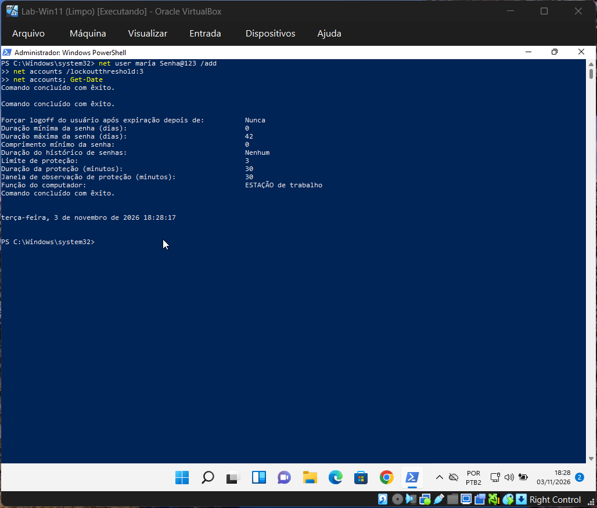

**Print 3a.** Tela de entrada: senha incorreta.


**Print 3b.** Tela de entrada: conta bloqueada, na 4ª tentativa.


**Print 4.** `net user maria`, com "Conta ativa: Bloqueado".
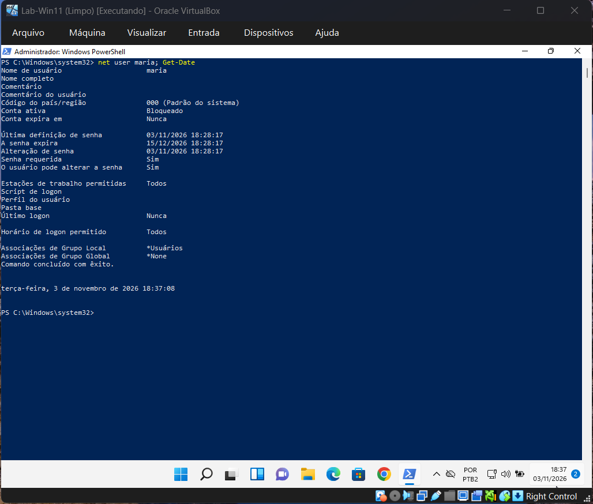

**Print 5.** Consulta `Win32_UserAccount`, com `Disabled False` e `Lockout True`.
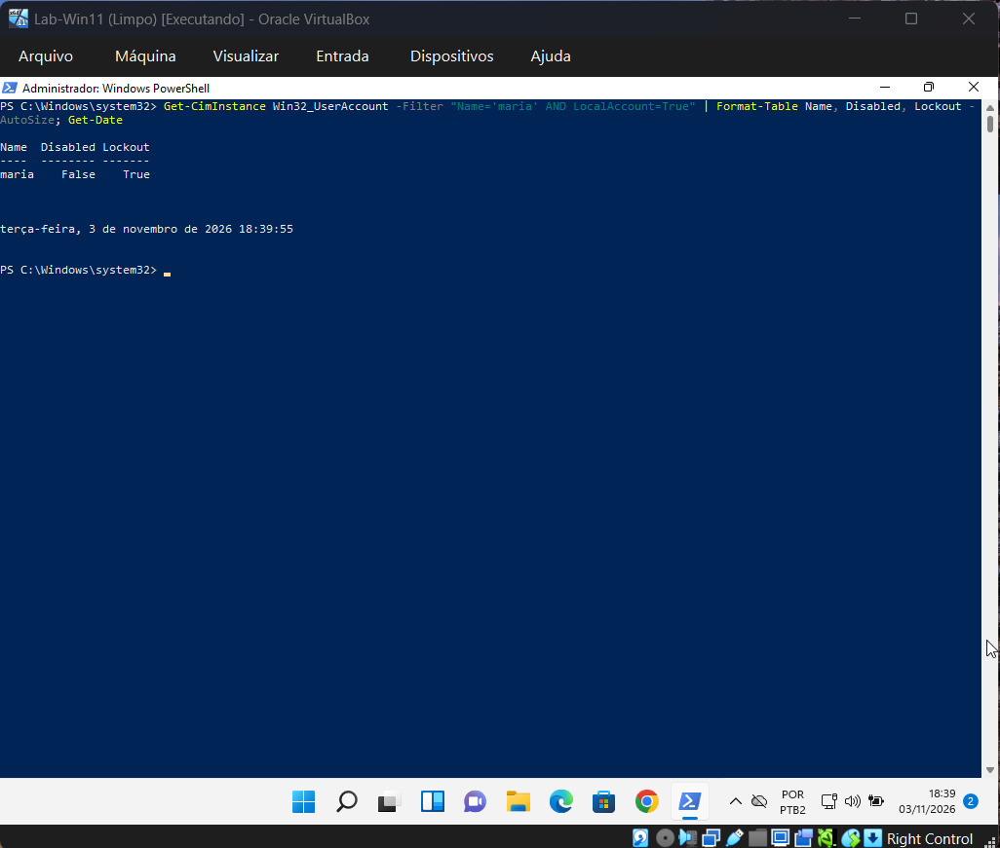

**Print 6.** Janela do `lusrmgr.msc`, com "Conta bloqueada" marcada.
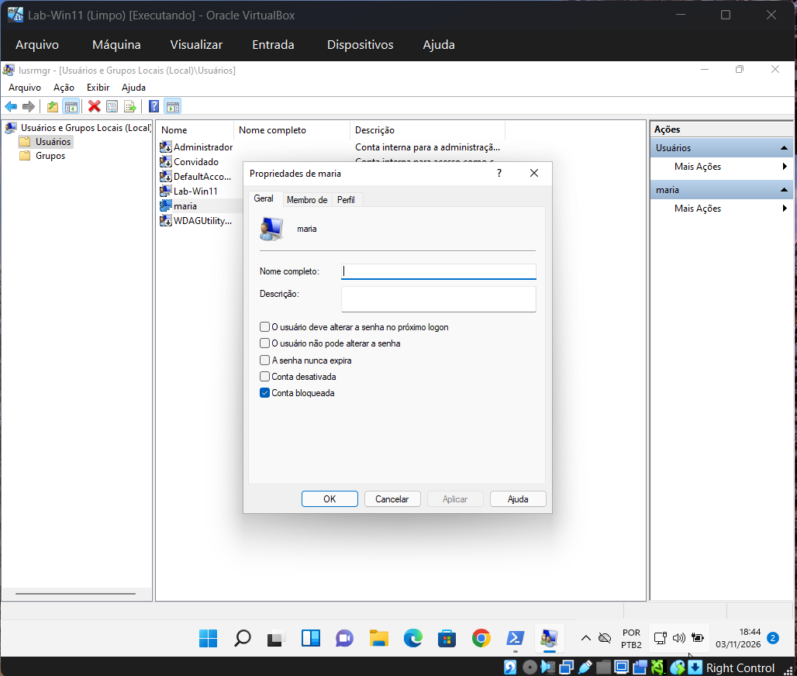

**Print 7.** Depois do `/active:yes`: `Lockout False`.
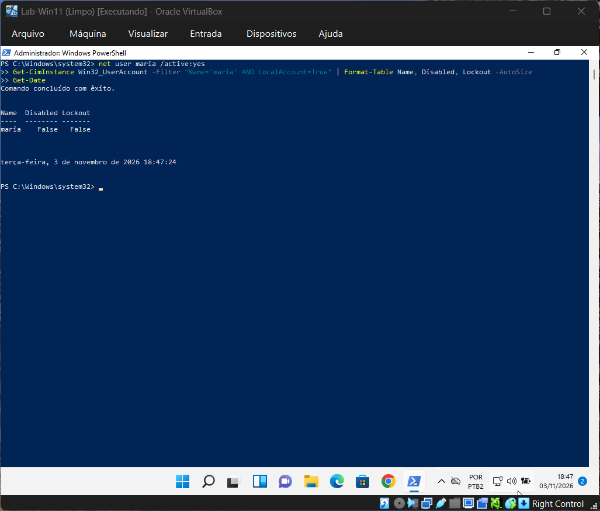

**Print 8.** Senha temporária definida e `PasswordLastSet` vazio.
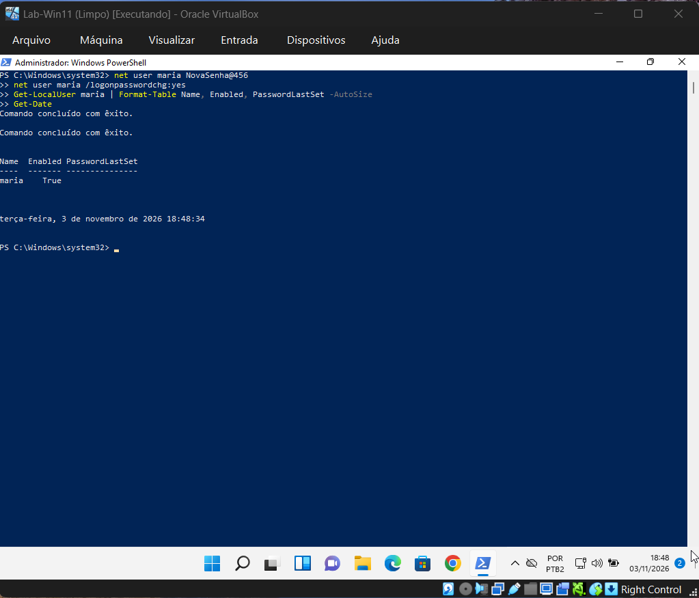

**Print 9a.** Aviso de que a senha deve ser alterada antes da entrada.
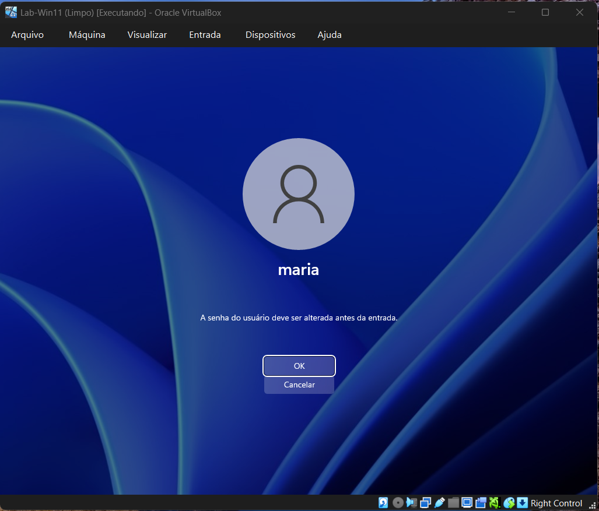

**Print 9b.** Tela com os três campos: senha antiga, nova e confirmação.
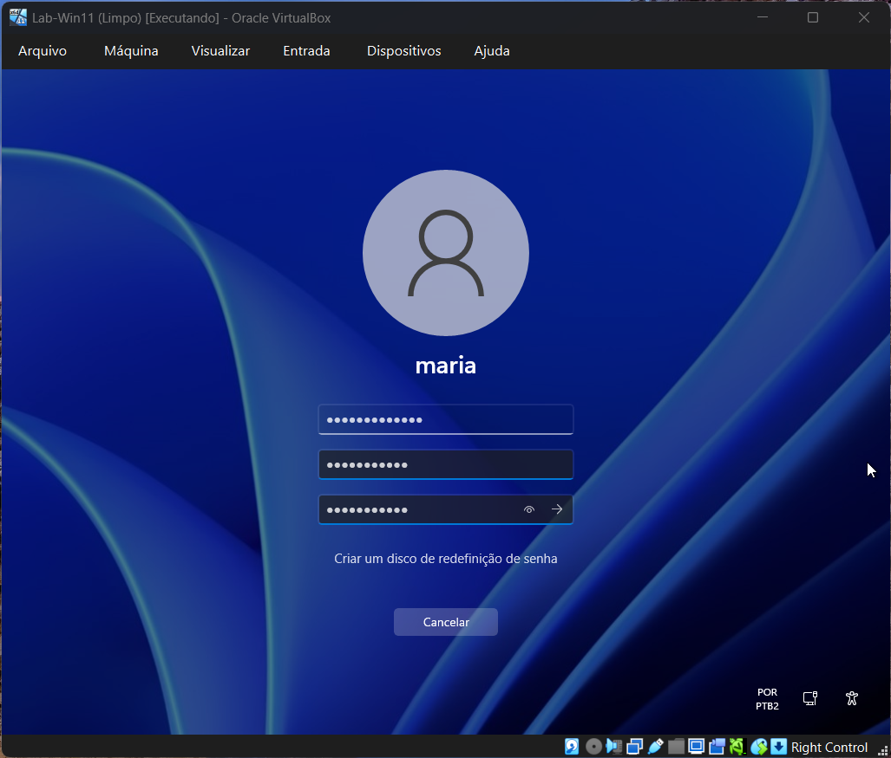

**Print 9c.** "A senha foi alterada."
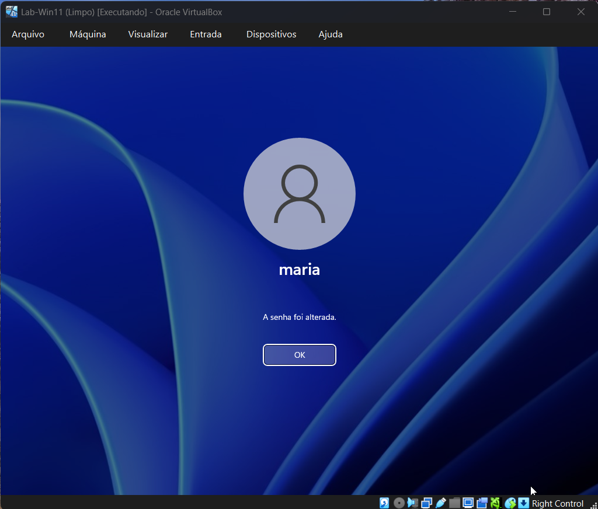

**Print 10.** `whoami` na conta da Maria.
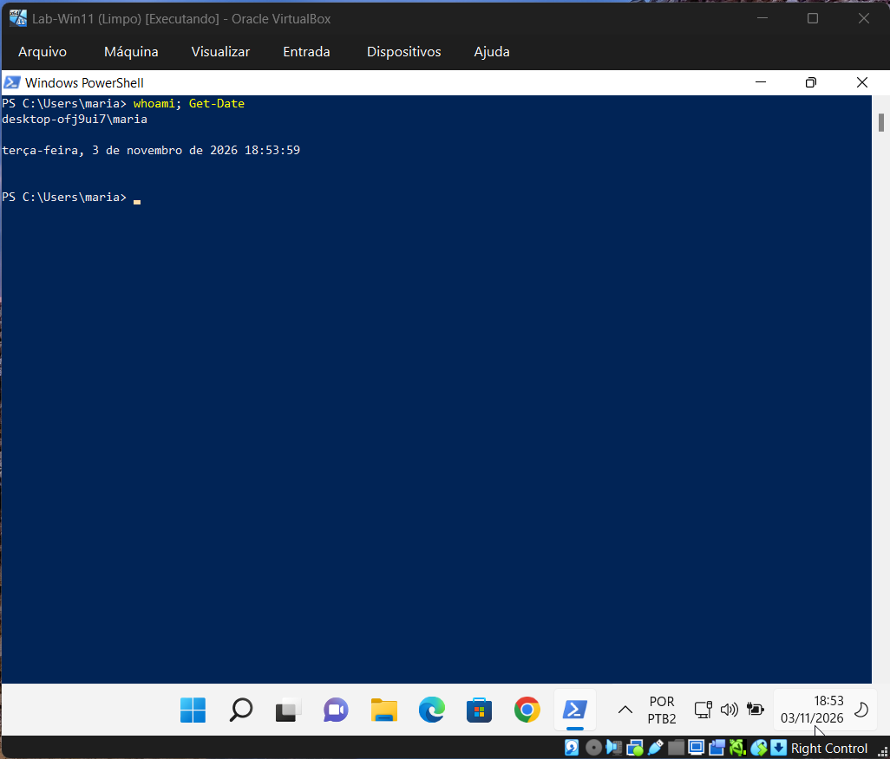

**Print 11.** Regra desfeita: limite de proteção em "Nunca".
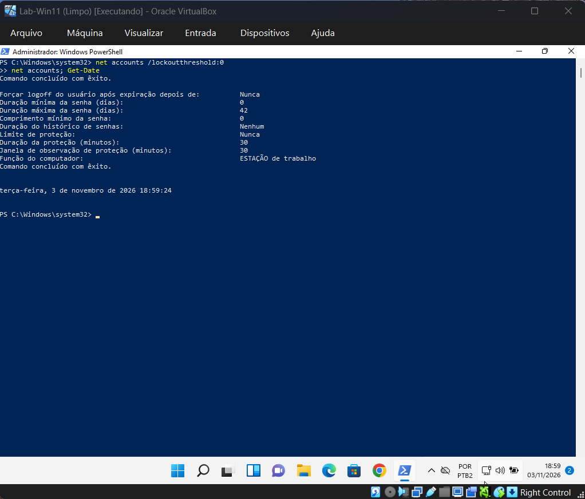
