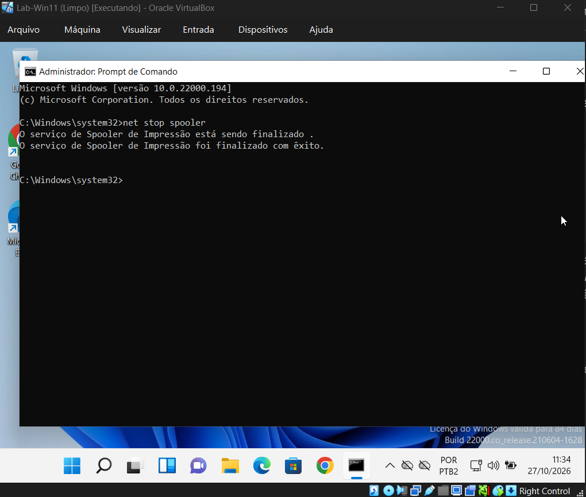
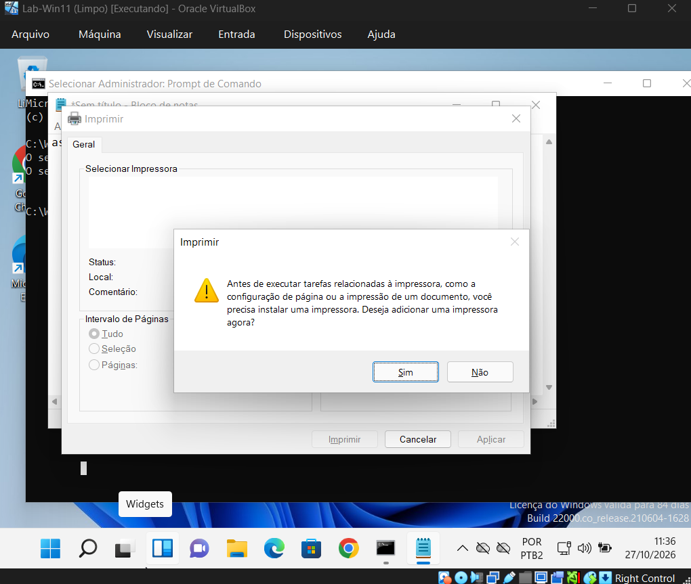
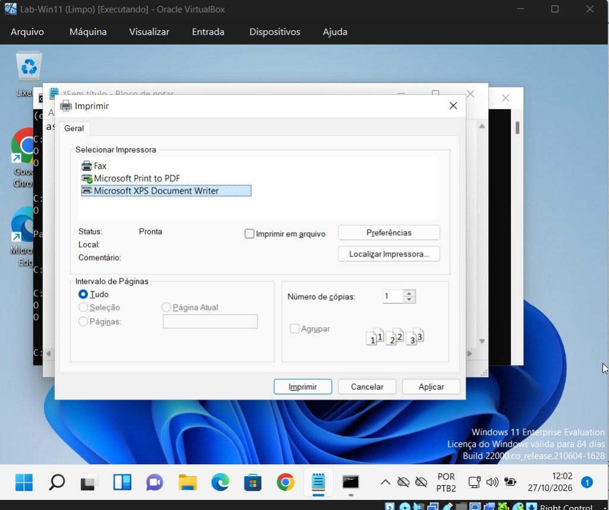
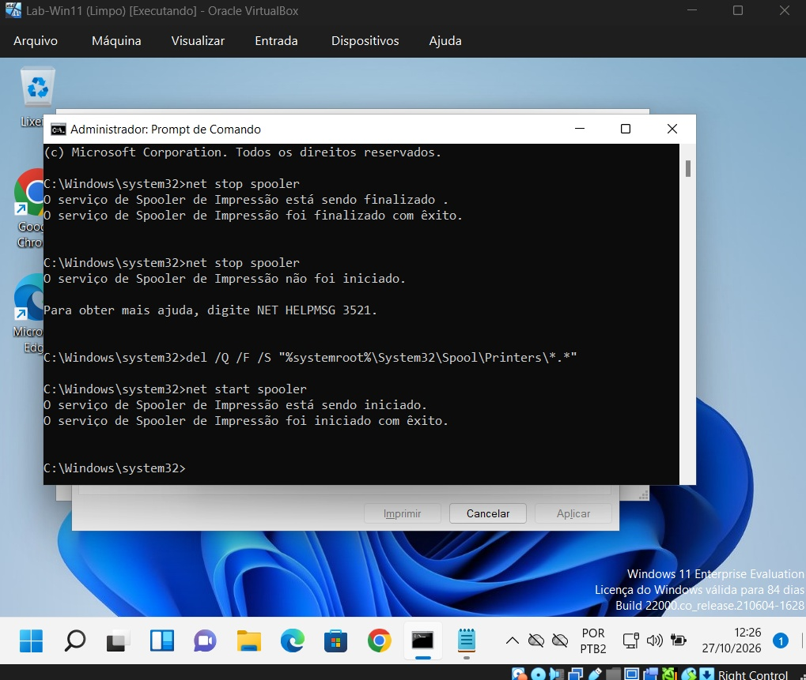

# Runbook 03: Não consigo imprimir

**Ambiente:** Windows 11 Enterprise Evaluation (10.0.22000.194), máquina virtual no VirtualBox · **Testado em:** 27/10/2026

## Sintoma
"Não consigo imprimir." No Bloco de Notas, ao abrir Imprimir, a lista de impressoras vem vazia e o Windows pergunta: "Antes de executar tarefas relacionadas à impressora [...] você precisa instalar uma impressora. Deseja adicionar uma impressora agora?"

## Impacto
Uma pessoa sem imprimir. Urgência média; alta se o documento é para entrega no mesmo dia.

## Antes de começar
Perguntar: acontece com todos os documentos ou só com um? Só neste PC ou também em outros que usam a mesma impressora? Desde quando? Mudou algo (atualização, driver)? Não aceitar de cara o aviso "adicionar uma impressora": neste caso as impressoras continuam instaladas e o que falhou foi o serviço de impressão.

## Como o defeito foi provocado
No Prompt de Comando como administrador: `net stop spooler`. O spooler é o serviço do Windows que recebe os trabalhos de impressão e organiza a fila. Ensaio em laboratório, dados fictícios.

## Diagnóstico
| Passo | Comando ou ação | Esperado (saudável) | Obtido no ensaio | Leitura |
| --- | --- | --- | --- | --- |
| 1 | Bloco de Notas → Arquivo → Imprimir | Lista com as impressoras instaladas | Lista vazia e o aviso para instalar uma impressora | O aplicativo não consegue listar as impressoras. Suspeitar do serviço de impressão, não de falta de impressora |
| 2 | `net stop spooler` (usado como teste no ensaio) | — | "O serviço de Spooler de Impressão não foi iniciado." (erro 3521) | O serviço já estava parado. Num atendimento real, prefira `sc query spooler`, que só consulta: o esperado é `STATE : 4 RUNNING` |

## Causa
Serviço Spooler de Impressão parado.

## Solução
1. `net start spooler`. Resposta no ensaio: "O serviço de Spooler de Impressão foi iniciado com êxito."
2. Se houver trabalhos presos na fila: `net stop spooler`, `del /Q /F /S "%systemroot%\System32\Spool\Printers\*.*"` e `net start spooler`. No ensaio, o `del` não listou nenhum arquivo apagado.

## Verificação
Arquivo → Imprimir lista as impressoras de novo (Fax, Microsoft Print to PDF e Microsoft XPS Document Writer); a selecionada aparece com status "Pronta".

## Escalonamento
Se o serviço não inicia, ou para de novo logo depois de iniciar, passar ao N2 com a mensagem exata do `net start spooler` e o que mudou antes (atualização, instalação de driver ou de impressora).

## Prevenção
Se repetir no mesmo PC, procurar atualização ou driver de impressora recente e registrar no chamado. Orientar o usuário a avisar o suporte quando a lista de impressoras aparecer vazia.

## Evidências

