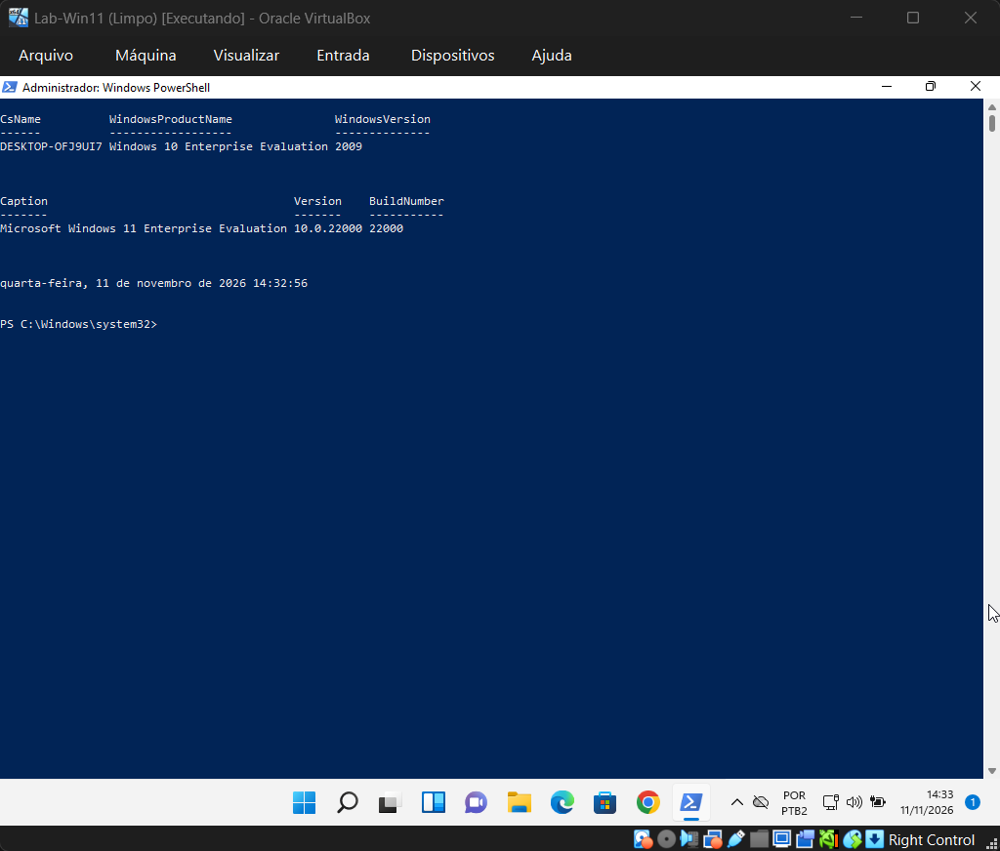
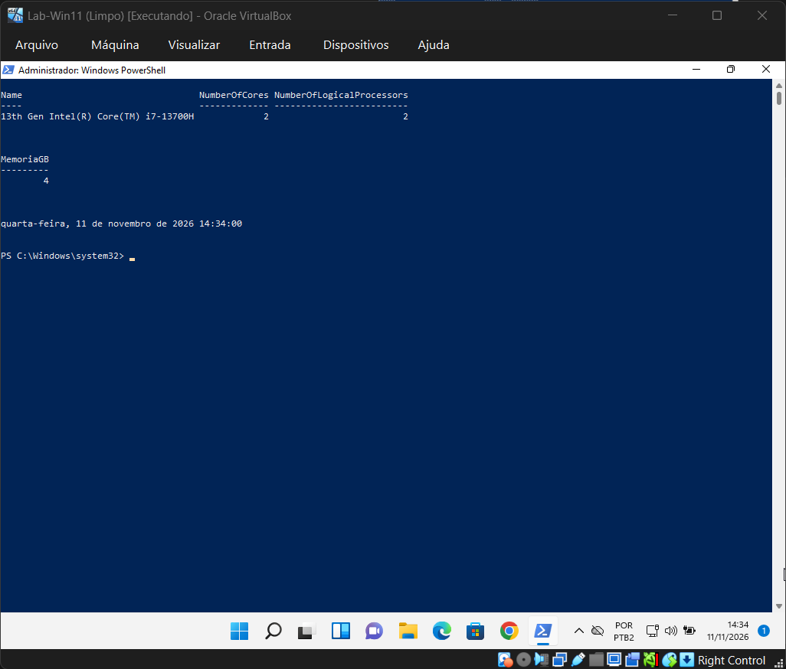
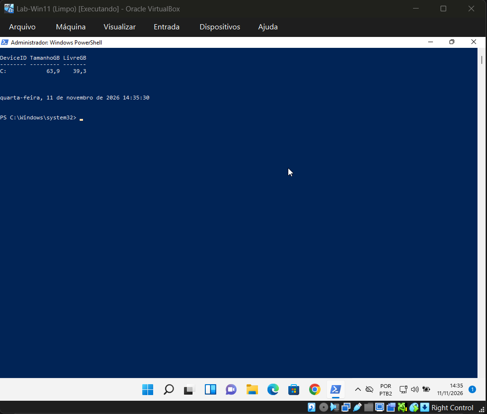
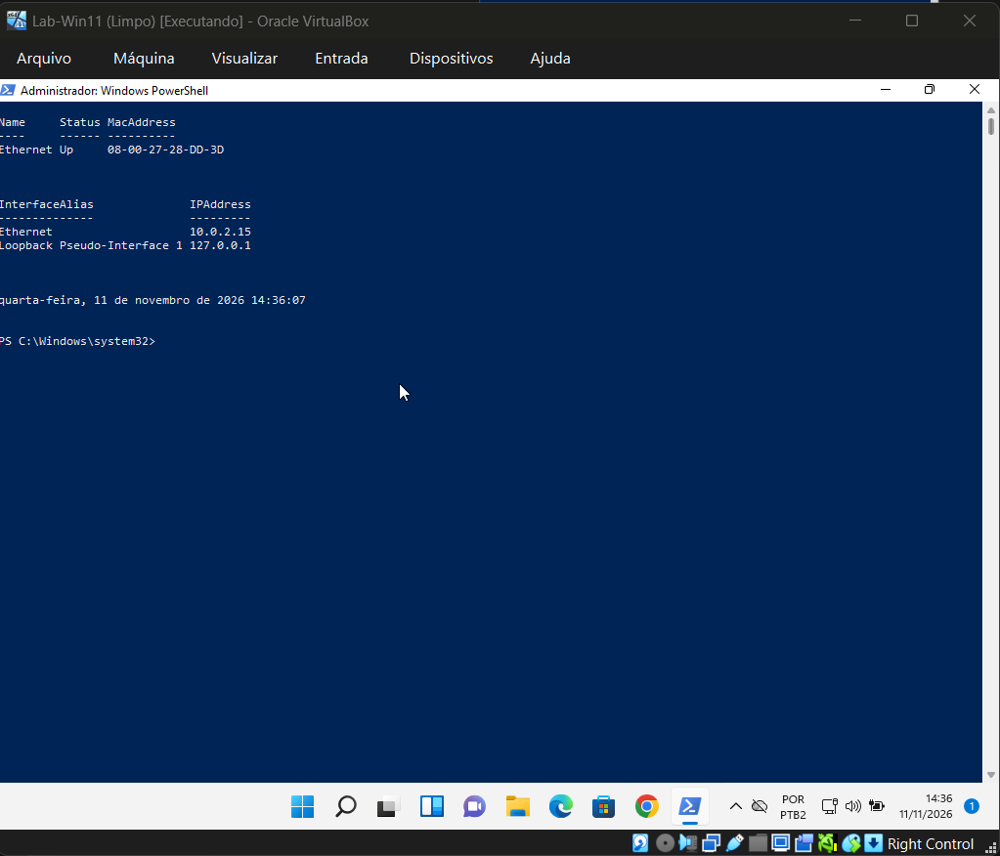
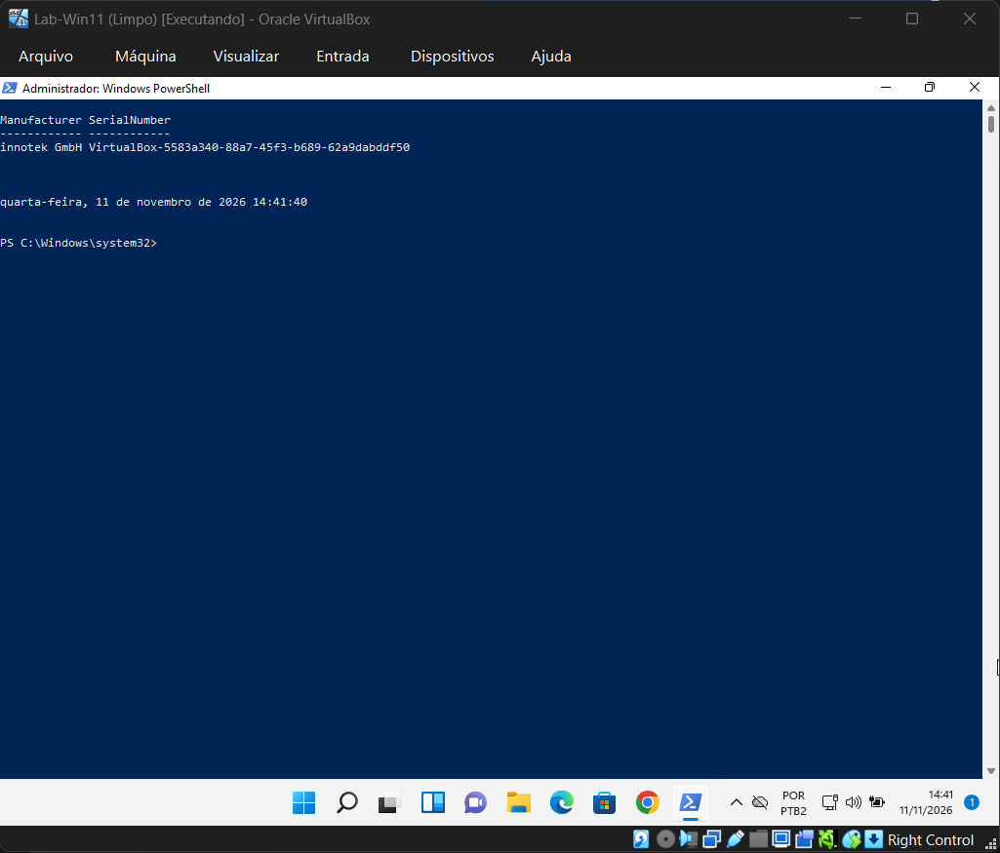
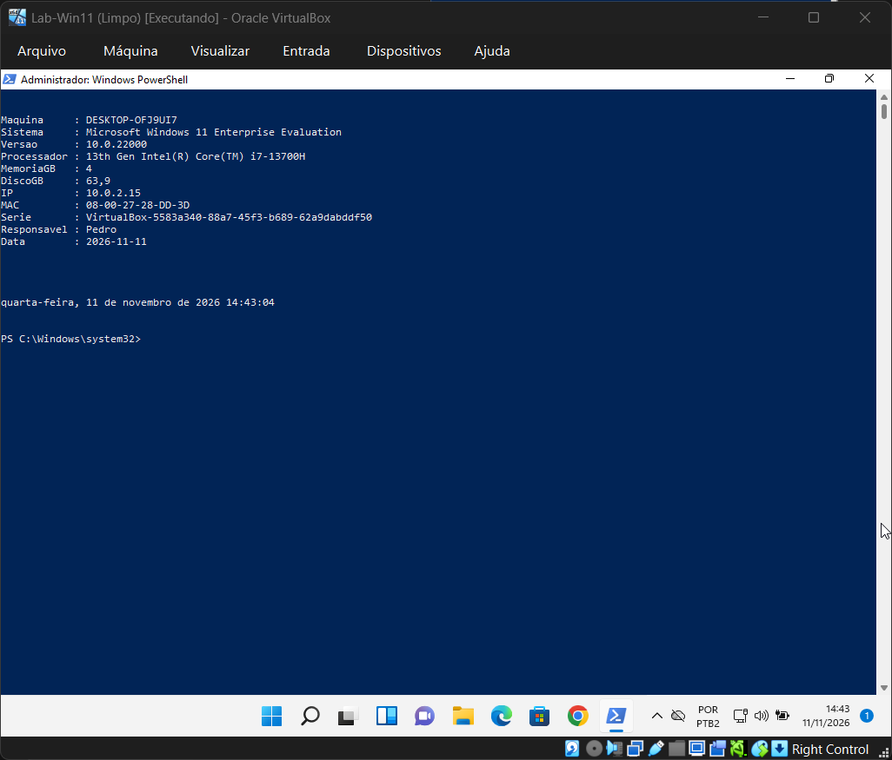
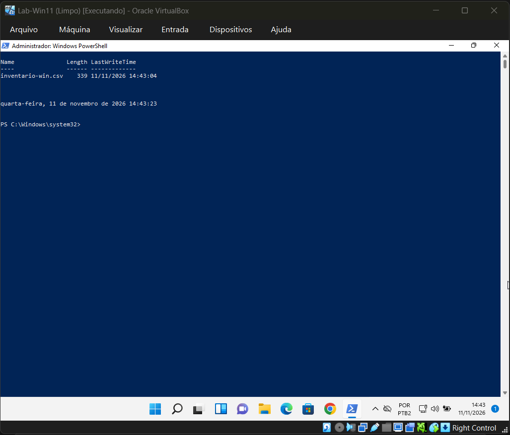
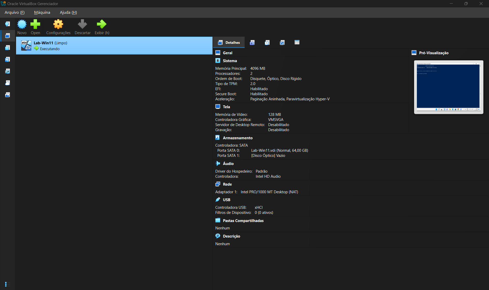

# Runbook 08: Preciso do inventário das máquinas

**Ambiente:** Windows 11 Enterprise Evaluation, máquina virtual no VirtualBox, a partir do snapshot "Limpo" · **Testado em:** 11/11/2026

## Pedido
"Preciso saber quais máquinas temos e como cada uma é." Neste chamado não há defeito. É um levantamento: registrar o que existe, guardar num arquivo CSV e conferir com o que foi configurado no VirtualBox. No ensaio, o levantamento foi de uma máquina só, a `Lab-Win11`.

## Impacto
Sem a lista, ninguém sabe ao certo o que existe: quanta memória e quanto disco cada máquina tem, qual sistema roda nela, quem responde por ela. Urgência baixa. Sobe se o pedido vier de uma auditoria ou de uma troca de equipamentos com data marcada.

## Antes de começar
Perguntar: o levantamento é de quais máquinas (uma, um setor, todas)? Que campos a pessoa quer (nome, sistema, memória, disco, rede, número de série, responsável)? Para que serve (auditoria, licenças, troca de equipamentos)? Onde o arquivo vai ficar guardado e quem pode abri-lo?

**O inventário traz IP, MAC e número de série das máquinas: guardar onde só quem precisa consegue abrir.** No laboratório os dados são os de uma máquina virtual descartável, então esse cuidado não foi testado.

Quatro termos. **Inventário** é a lista das máquinas e das características de cada uma (nome, sistema, memória, disco, IP, número de série). **CSV** é uma tabela em texto simples, que abre no Excel, com uma máquina por linha. **IP** é o endereço da máquina na rede, por exemplo `10.0.2.15`. **MAC** é o endereço físico da placa de rede, por exemplo `08-00-27-28-DD-3D`.

## Como foi feito
Partindo do snapshot "Limpo", com o PowerShell aberto como administrador. Colei cada bloco com o `cls` (que limpa a tela) na primeira linha e dei Enter. Todo bloco termina com `Get-Date`, que mostra a hora.

**Passo 1: nome e sistema (print 1).**

```
cls
Get-ComputerInfo | Select-Object CsName, WindowsProductName, WindowsVersion | Format-Table -AutoSize; Get-CimInstance Win32_OperatingSystem | Select-Object Caption, Version, BuildNumber | Format-Table -AutoSize; Get-Date
```

O primeiro comando mostra o nome do computador, o nome do produto e a versão do Windows. O segundo pergunta pelo sistema usando a classe `Win32_OperatingSystem` (nome, versão e build). Pedi os dois porque os nomes de produto podem não combinar. O roteiro avisa que o `Get-ComputerInfo` leva de 10 a 30 segundos. Não cronometrei.

**Passo 2: processador e memória (print 2).**

```
cls
Get-CimInstance Win32_Processor | Select-Object Name, NumberOfCores, NumberOfLogicalProcessors | Format-Table -AutoSize; Get-CimInstance Win32_ComputerSystem | Select-Object @{n='MemoriaGB';e={[math]::Round($_.TotalPhysicalMemory/1GB,1)}} | Format-Table -AutoSize; Get-Date
```

O primeiro comando mostra o nome do processador, o número de núcleos e o de processadores lógicos. O segundo mostra a memória em GB: o Windows responde em bytes, e a conta `/1GB` converte, com uma casa decimal.

**Passo 3: disco (print 3).**

```
cls
Get-CimInstance Win32_LogicalDisk -Filter "DriveType=3" | Select-Object DeviceID, @{n='TamanhoGB';e={[math]::Round($_.Size/1GB,1)}}, @{n='LivreGB';e={[math]::Round($_.FreeSpace/1GB,1)}} | Format-Table -AutoSize; Get-Date
```

Mostra os discos fixos (`DriveType=3`), com o tamanho e o espaço livre em GB.

**Passo 4: rede (print 4).**

```
cls
Get-NetAdapter | Select-Object Name, Status, MacAddress | Format-Table -AutoSize; Get-NetIPAddress -AddressFamily IPv4 | Select-Object InterfaceAlias, IPAddress | Format-Table -AutoSize; Get-Date
```

O `Get-NetAdapter` mostra a placa de rede (nome, estado e MAC). O `Get-NetIPAddress` mostra os endereços IPv4 da máquina.

**Passo 5: fabricante e número de série (print 5).**

```
cls
Get-CimInstance Win32_BIOS | Select-Object Manufacturer, SerialNumber | Format-Table -AutoSize; Get-Date
```

**Passo 6: a ficha em CSV (print 6).** Juntei tudo numa linha de inventário e salvei em CSV. Colei o bloco inteiro de uma vez:

```
cls
New-Item -ItemType Directory -Path C:\Temp -Force | Out-Null
$cs   = Get-CimInstance Win32_ComputerSystem
$os   = Get-CimInstance Win32_OperatingSystem
$cpu  = Get-CimInstance Win32_Processor | Select-Object -First 1
$dsk  = Get-CimInstance Win32_LogicalDisk -Filter "DeviceID='C:'"
$nic  = Get-NetAdapter | Where-Object Status -eq 'Up' | Select-Object -First 1
$ip   = (Get-NetIPAddress -InterfaceIndex $nic.ifIndex -AddressFamily IPv4).IPAddress
$bios = Get-CimInstance Win32_BIOS
[pscustomobject]@{
    Maquina     = $cs.Name
    Sistema     = $os.Caption
    Versao      = $os.Version
    Processador = $cpu.Name
    MemoriaGB   = [math]::Round($cs.TotalPhysicalMemory / 1GB, 1)
    DiscoGB     = [math]::Round($dsk.Size / 1GB, 1)
    IP          = $ip
    MAC         = $nic.MacAddress
    Serie       = $bios.SerialNumber
    Responsavel = 'Pedro'
    Data        = (Get-Date -Format 'yyyy-MM-dd')
} | Export-Csv C:\Temp\inventario-win.csv -NoTypeInformation -Encoding UTF8
Import-Csv C:\Temp\inventario-win.csv | Format-List
Get-Date
```

O que o bloco faz:
- A primeira linha cria a pasta `C:\Temp` (o `-Force` não dá erro se ela já existe), e o `| Out-Null` esconde a resposta.
- As linhas com `$cs`, `$os`, `$cpu`, `$dsk`, `$nic`, `$ip` e `$bios` guardam em variáveis o que o Windows respondeu. O `$nic` é a primeira placa de rede com estado `Up`, e o `$ip` é o IPv4 dela.
- O `[pscustomobject]@{ ... }` monta a ficha, com um campo por linha. O `Responsavel` é um texto digitado no bloco, e a `Data` vem do `Get-Date`.
- O `Export-Csv` grava o arquivo `C:\Temp\inventario-win.csv`. O `-NoTypeInformation` tira uma linha técnica que o PowerShell põe no começo, e o `-Encoding UTF8` mantém os acentos.
- O `Import-Csv ... | Format-List` lê o arquivo de volta e mostra a ficha em lista. Isso confirma que o arquivo foi gravado e dá para ler.

O roteiro avisava que este bloco foi escrito sem rodar numa máquina virtual. Ele rodou sem erro (print 6).

**Passo 7: o arquivo salvo (print 7).**

```
cls
Get-Item C:\Temp\inventario-win.csv | Select-Object Name, Length, LastWriteTime | Format-Table -AutoSize; Get-Date
```

**Passo 8: conferir com o VirtualBox (print 8).** No VirtualBox Manager (a janela com a lista de máquinas), selecionei a `Lab-Win11` e deixei a aba Detalhes aberta. O print mostra só a janela do Manager.

## Resultado: o que o Windows informou
O número do print aponta para a seção Evidências. A hora entre parênteses vem do `Get-Date`.

| Print | Passo | Obtido no ensaio | Leitura |
| --- | --- | --- | --- |
| 1 | Nome e sistema | `Get-ComputerInfo`: `DESKTOP-OFJ9UI7`, produto "Windows 10 Enterprise Evaluation", versão `2009`. `Win32_OperatingSystem`: "Microsoft Windows 11 Enterprise Evaluation", versão `10.0.22000`, build `22000` (14:32:56) | Os dois nomes de produto não combinam: um diz Windows 10 e o outro diz Windows 11. O roteiro previa essa possibilidade. Não investiguei o motivo. Na ficha usei o nome do `Win32_OperatingSystem` |
| 2 | Processador e memória | "13th Gen Intel(R) Core(TM) i7-13700H", 2 núcleos, 2 processadores lógicos. Memória: 4 GB (14:34:00) | A máquina virtual tem 2 núcleos (print 8). O nome do processador provavelmente é o do PC físico que hospeda a máquina virtual. Não conferi |
| 3 | Disco | `C:` com 63,9 GB de tamanho e 39,3 GB livres (14:35:30) | Só uma unidade fixa apareceu, o `C:`. Os números têm vírgula como separador decimal porque o Windows está em português |
| 4 | Rede | Placa `Ethernet`, estado `Up`, MAC `08-00-27-28-DD-3D`. IPv4: `10.0.2.15` (`Ethernet`) e `127.0.0.1` (`Loopback Pseudo-Interface 1`) (14:36:07) | O `127.0.0.1` é a máquina falando com ela mesma. O IP da máquina na rede é o `10.0.2.15` |
| 5 | Fabricante e número de série | Fabricante `innotek GmbH`. Número de série `VirtualBox-5583a340-88a7-45f3-b689-62a9dabddf50` (14:41:40) | O número de série começa com `VirtualBox-`: é da máquina virtual, e não de um equipamento físico. O roteiro dizia que numa máquina virtual ele costuma ser um valor genérico |
| 6 | Ficha em CSV | A ficha abaixo, lida de volta do arquivo (14:43:04) | O bloco rodou sem erro |
| 7 | Arquivo salvo | `inventario-win.csv`, 339 bytes, gravado em 11/11/2026 às 14:43:04 (14:43:23) | A hora de gravação é a mesma do `Get-Date` da ficha (print 6) |

A ficha do print 6, com a origem de cada campo:

| Campo | Valor | De onde vem |
| --- | --- | --- |
| `Maquina` | `DESKTOP-OFJ9UI7` | Nome em `Win32_ComputerSystem` |
| `Sistema` | `Microsoft Windows 11 Enterprise Evaluation` | `Caption` de `Win32_OperatingSystem` |
| `Versao` | `10.0.22000` | `Version` de `Win32_OperatingSystem` |
| `Processador` | `13th Gen Intel(R) Core(TM) i7-13700H` | Nome em `Win32_Processor` (o primeiro) |
| `MemoriaGB` | `4` | Memória física de `Win32_ComputerSystem`, em GB |
| `DiscoGB` | `63,9` | Tamanho do `C:` em `Win32_LogicalDisk`, em GB |
| `IP` | `10.0.2.15` | IPv4 da primeira placa `Up` (`Get-NetIPAddress`) |
| `MAC` | `08-00-27-28-DD-3D` | `MacAddress` dessa placa (`Get-NetAdapter`) |
| `Serie` | `VirtualBox-5583a340-88a7-45f3-b689-62a9dabddf50` | `SerialNumber` de `Win32_BIOS` |
| `Responsavel` | `Pedro` | Texto digitado no bloco |
| `Data` | `2026-11-11` | `Get-Date`, no formato `yyyy-MM-dd` |

## Conferência com o VirtualBox (print 8)
O painel Detalhes mostra o que foi configurado no VirtualBox. Comparei com o que o Windows informou.

| Item | No Windows | No VirtualBox (print 8) | Leitura |
| --- | --- | --- | --- |
| Memória | 4 GB (prints 2 e 6) | Memória Principal: 4096 MB | Bate: 4096 MB são 4 GB |
| Processadores | 2 núcleos e 2 processadores lógicos (print 2) | Processadores: 2 | Bate |
| Disco | `C:` com 63,9 GB (prints 3 e 6) | `Lab-Win11.vdi` (Normal, 64,00 GB), na Porta SATA 0 | Diferença de 0,1 GB. Uma explicação provável: o disco tem outras partições pequenas além do `C:`. Não conferi |
| Rede | IP `10.0.2.15` e MAC `08-00-27-28-DD-3D` (print 4) | Adaptador 1: Intel PRO/1000 MT Desktop (NAT) | O painel mostra o tipo da placa e o modo (NAT), mas não o IP nem o MAC. Esses dois não foram conferidos |
| Sistema | "Microsoft Windows 11 Enterprise Evaluation" (print 1) | A seção Geral veio recolhida, sem o nome do sistema | Não conferido |

Resumo: memória e processadores batem. No disco há 0,1 GB de diferença. IP e MAC não aparecem nesse painel. Anotei também a diferença do nome do produto (print 1). O roteiro pede isso: o que não bate é a parte útil de um inventário.

## E num PC de verdade
- **Várias máquinas.** O laboratório tem uma máquina. Para várias, o mesmo bloco precisa rodar em cada uma, ou ser rodado à distância, ou o levantamento vem de uma ferramenta de gerenciamento. **Não testado.**
- **Mais campos.** Programas instalados, data da última atualização, setor, data de compra: o roteiro não pede, e **não testei**.
- **Responsável e data.** O `Responsavel` foi digitado no bloco. Num caso real, o nome vem de quem pediu ou do cadastro da empresa. **Não testado.**
- **PC físico.** Aqui o fabricante e o número de série vieram do VirtualBox (print 5). Num PC físico eles dependem do equipamento. **Não testado.**
- **O CSV no Excel.** O Windows em português usa vírgula como separador decimal (`63,9`), e o Excel em português costuma esperar `;` entre as colunas. O arquivo foi gravado com vírgula entre as colunas e **não o abri no Excel**, então não sei como ele aparece lá. O `Export-Csv` tem o parâmetro `-UseCulture`, que usa o separador do Windows. **Não testado.**
- **Guardar o arquivo.** No laboratório o arquivo ficou em `C:\Temp`, dentro da própria máquina virtual. Num caso real, guardar num lugar combinado, com acesso restrito. **Não testado.**

## Escalonamento
Passar ao N2 (o segundo nível do suporte) se:
- o pedido é de muitas máquinas, de programas instalados ou de licenças (o laboratório fez uma máquina e não listou programas);
- algum comando dá erro, ou volta vazio;
- o que o Windows mostra é muito diferente do cadastro (por exemplo, memória ou disco com valores bem diferentes) e não se explica;
- o inventário precisa ficar num sistema da empresa, e não num arquivo solto.

No ensaio só apareceram duas diferenças pequenas (o nome do produto no print 1 e os 0,1 GB de disco no print 8). Anotei as duas e não escalei. As outras situações não aconteceram, então não foram testadas.

## Prevenção
- Padronizar o bloco: os mesmos campos em todas as máquinas, para as fichas poderem ser juntadas. Não testado com mais de uma máquina.
- Guardar a data na ficha (campo `Data`) e refazer o levantamento quando a máquina mudar. Não testado.
- Conferir o que o Windows mostra com o cadastro (aqui, o VirtualBox) e anotar o que não bate.
- Guardar o arquivo onde só quem precisa consegue abrir (IP, MAC e número de série).

## Notas do ensaio
**Tempo gasto.** Do primeiro comando (print 1, 14:32:56) ao último print (print 8, enviado às 14:46) passaram cerca de 13 minutos. O roteiro estimava 30 minutos. Não contei a restauração do snapshot "Limpo" antes do print 1. O print 8 não mostra relógio, porque a janela do VirtualBox Manager não tem, então o tempo é aproximado.

**O que não funcionou.** Nada falhou, e não tentei nada fora do roteiro.

**Diferenças em relação ao previsto.**
- Acrescentei `| Format-Table -AutoSize` depois de cada `Select-Object` dos passos 1 a 5 e 7, e o `cls` como primeira linha de cada bloco colado (o roteiro manda dar `cls` antes de cada bloco). O motivo do `Format-Table`: no chamado 07 o `Get-Date` saiu em formato de lista depois de um comando sem ele (ver os runbooks 06 e 07). Neste chamado não rodei os comandos sem o `Format-Table`.
- O nome do produto no `Get-ComputerInfo` não combinou com o do `Win32_OperatingSystem` (print 1). O roteiro previa essa possibilidade.
- O número de série da máquina virtual saiu como `VirtualBox-` seguido de um código (print 5).
- O bloco do passo 6, que o roteiro avisava não ter sido testado numa máquina virtual, rodou sem erro (print 6).
- No VirtualBox Manager a seção Geral veio recolhida (print 8). As seções Sistema e Armazenamento bastaram para a conferência de memória, processadores e disco.

**Prints que não publiquei.** Nenhum. Os 8 prints do ensaio estão nas Evidências.

**O que não conferi.**
- Por que os dois nomes de produto não combinam (print 1).
- A diferença de 0,1 GB no disco (prints 3 e 8): não rodei `Get-Partition`.
- O texto do arquivo `inventario-win.csv`. Vi a ficha lida de volta pelo `Import-Csv` (print 6) e o tamanho, 339 bytes (print 7), mas não abri o arquivo no Bloco de Notas nem no Excel. O tamanho bate com o texto esperado: cabeçalho e uma linha, todos os valores entre aspas, mais 3 bytes do marcador de UTF-8 no começo. Essa conta foi feita fora da máquina, sem o arquivo.
- A versão completa do Windows. O `Win32_OperatingSystem` mostra `10.0.22000` e build `22000`, sem o número final. O `10.0.22000.194` do README não foi conferido neste ensaio.
- Se o `10.0.2.15` é o IP que o VirtualBox entrega por padrão no modo NAT.
- Se o nome do processador é o do PC físico (print 2).

## Fontes
Nenhuma fonte externa. Os comandos vêm do roteiro do laboratório, e o resto está nos prints.

## Evidências
**Print 1.** Nome do computador e sistema, pelos dois comandos (14:32:56).


**Print 2.** Processador, núcleos e memória (14:34:00).


**Print 3.** O disco `C:` com tamanho e espaço livre (14:35:30).


**Print 4.** A placa de rede com o MAC, e os endereços IPv4 (14:36:07).


**Print 5.** Fabricante e número de série (14:41:40).


**Print 6.** A ficha da máquina, lida de volta do arquivo CSV (14:43:04).


**Print 7.** O arquivo `inventario-win.csv` com tamanho e data (14:43:23).


**Print 8.** VirtualBox Manager, painel Detalhes da `Lab-Win11`, para conferir memória, processadores e disco (sem relógio).

